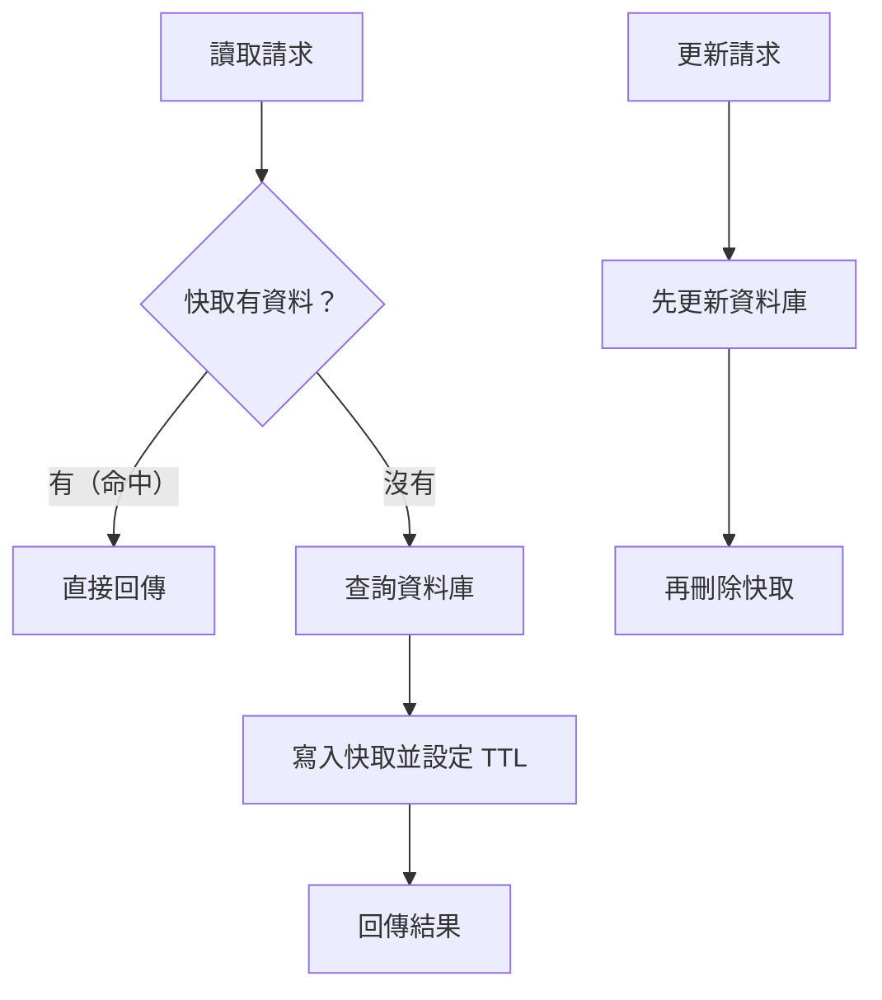

# 07. 快取

> **一句話**：把常用資料放在更快的地方。快取是效能優化的第一招，但也是資料不一致的主要來源。

## 學習目標

- 說明快取的層級與 Cache-Aside 讀寫流程
- 解釋快取穿透、擊穿、雪崩並提出解法
- 依資料特性選擇 Redis 資料結構

---

## 1. 快取放在哪裡 🟢

從使用者到資料庫，每一層都可以快取：

```
瀏覽器快取 → CDN → 反向代理 → 應用程式記憶體 → Redis → 資料庫
```

| 層級 | 適合 | 注意 |
|---|---|---|
| 瀏覽器 / CDN | 圖片、JS、CSS 等靜態檔 | 更新時要改檔名或版本號 |
| 應用程式記憶體 | 極熱、很少變的資料（設定、字典表） | 多台伺服器間不同步 |
| **Redis（分散式快取）** | 多台伺服器共用的資料、Session | 最常用 |

## 2. 最常用的模式：Cache-Aside 🟢



- 為什麼是「刪除」而不是「更新」快取？避免兩個並行請求互相覆蓋，造成快取存到舊值。
- 一定要設定 **TTL（過期時間）**，就算出錯也會自動修正。

## 3. 三大經典問題（面試必考）🟡

| 問題 | 情境 | 解法 |
|---|---|---|
| **快取穿透** | 一直查「不存在」的資料，每次都打到資料庫 | 不存在也快取一個空值；或用布隆過濾器先擋 |
| **快取擊穿** | 某個超熱門的 key 剛好過期，瞬間大量請求衝進資料庫 | 只讓一個請求去重建（加鎖），其他等待 |
| **快取雪崩** | 大量 key 同時過期，或 Redis 整個掛掉 | TTL 加上隨機值、Redis 高可用、多級快取 |

## 4. Redis 必懂 🟡

- **為什麼快**：資料在記憶體、單執行緒處理指令（無鎖競爭）
- **常用資料結構與用途**：

| 結構 | 用途 |
|---|---|
| String | 快取物件、計數器 |
| Hash | 存物件欄位（使用者資料） |
| List | 簡易佇列 |
| Set | 去重、共同好友 |
| Sorted Set | 排行榜 |

- **持久化**：RDB（定期快照）、AOF（記錄每筆寫入），可兩者並用
- **高可用**：Sentinel（主從自動切換）、Cluster（資料分片）
- **記憶體滿了怎麼辦**：淘汰策略，常用 LRU（淘汰最久沒用的）

## 5. 什麼不該快取 🟢

- 強一致性要求的資料（帳戶餘額的最終判斷）
- 變動極頻繁、讀取很少的資料
- 個資等敏感資料（若要快取需控管存取與期限）

---

## 動手練習

1. **實作 Cache-Aside**：用 Docker 啟動 Redis，為一個查詢 API 加上快取與 TTL，用壓測工具比較加快取前後的回應時間。
2. **重現快取擊穿**：讓熱門 key 過期的同時用 k6 送大量請求，觀察資料庫查詢次數；再加上互斥鎖重建快取比較。
3. **排行榜**：用 Redis Sorted Set 實作遊戲分數排行榜 API（加分、前 10 名、查自己名次）。

## 面試常問

> 先試著自己回答，再對照參考解答。

### Q1. 快取穿透、擊穿、雪崩分別是什麼？怎麼解？

- **穿透**：查詢**根本不存在**的資料，快取永遠沒有命中，每次都打到資料庫（常見於惡意攻擊）
  - 解：把「查無資料」也快取（空值 + 短 TTL）、用**布隆過濾器**先判斷 key 是否可能存在、參數驗證
- **擊穿**：某個**超熱門 key 過期**的瞬間，大量請求同時打到資料庫
  - 解：**互斥鎖**，只讓一個請求重建快取，其他等待或回傳舊值；熱門 key 不設過期，改由背景更新
- **雪崩**：**大量 key 同時過期**，或 Redis 整個掛掉，流量全部壓到資料庫
  - 解：TTL 加上**隨機值**分散過期時間、Redis 高可用（Sentinel / Cluster）、多級快取、限流與降級

### Q2. 如何保證快取與資料庫一致？

無法做到絕對強一致，目標是**最終一致且不一致時間盡量短**。常見做法：
1. **先更新資料庫，再刪除快取**（Cache-Aside 標準做法）
2. 所有快取都設 **TTL**，就算刪除失敗，過期後也會自動修正
3. 刪除快取失敗時**重試**（例如丟到 MQ 重試）
4. 要求更高時，用 **CDC**（例如 Debezium 監聽資料庫變更日誌）自動刪除快取
5. 可搭配**延遲雙刪**：更新資料庫前後各刪一次快取，降低併發讀取寫回舊值的機率

對一致性要求極高的資料（如餘額），關鍵判斷直接讀資料庫。

### Q3. 為什麼更新資料時是刪除快取而不是更新快取？

- **避免併發寫入順序錯亂**：兩個請求同時更新，A 先寫資料庫、B 後寫資料庫，但 B 先更新快取、A 後更新快取 → 快取最終是 A 的舊值，且一直錯到過期
- **避免浪費**：有些資料寫多讀少，每次更新都重算快取卻沒人讀
- **計算成本**：快取值可能是多張表組合的結果，刪除後由下次讀取時重建較簡單

刪除後下一次讀取會從資料庫載入最新資料，邏輯單純、出錯機率低。

### Q4. Redis 為什麼快？單執行緒為什麼還能高效能？

**快的原因**：
- 資料存在**記憶體**，沒有磁碟 I/O
- 高效的資料結構（雜湊表、跳表等）
- **I/O 多工**（epoll），單一執行緒即可同時處理大量連線

**單執行緒仍高效**：
- Redis 的瓶頸通常是**網路與記憶體**，不是 CPU
- 單執行緒**沒有鎖競爭與執行緒切換成本**，每個指令天然是原子操作
- 新版 Redis 已將網路 I/O 改為多執行緒，但**指令執行仍是單執行緒**

注意：因為單執行緒，執行耗時指令（如對大集合用 `KEYS *`）會阻塞所有請求，正式環境應改用 `SCAN`。

### Q5. Redis 如何做排行榜？

使用 **Sorted Set（有序集合）**，每個成員有一個分數，Redis 自動依分數排序。
- 加分：`ZINCRBY leaderboard 10 user:123`
- 取前 10 名：`ZREVRANGE leaderboard 0 9 WITHSCORES`
- 查某人名次：`ZREVRANK leaderboard user:123`

這些操作的時間複雜度約為 O(log n)，即使數百萬名使用者也能即時查詢。可依時間切分 key（如 `leaderboard:2026-11`）做週榜、月榜。

## 過時技術（知道就好）

- **Memcached**：仍有使用，但功能單純，新專案多直接選 Redis（或其開源分支 Valkey）。

## 本章回顧

- 讀多寫少才適合快取
- 預設用 Cache-Aside + TTL
- 背熟穿透 / 擊穿 / 雪崩三個問題與解法
