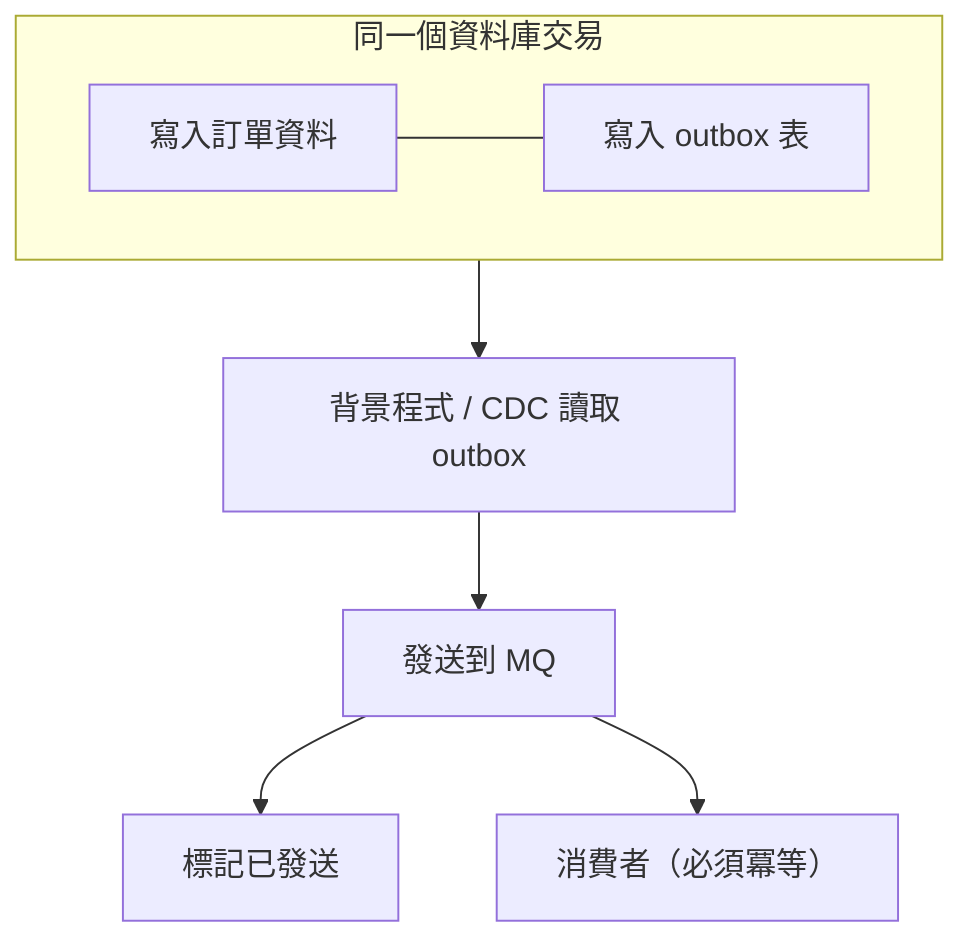

# 08. 訊息佇列與事件驅動

> **一句話**：把「立刻做」變成「排隊做」。讓系統解耦、扛住尖峰，但代價是變成非同步、需要處理重複與失敗。

## 學習目標

- 說明訊息佇列帶來的解耦、非同步、削峰效益與代價
- 依情境選擇 RabbitMQ 或 Kafka
- 設計冪等消費者與死信佇列處理重複與失敗
- 用 Outbox Pattern 保證資料寫入與訊息發送一致

---

## 1. 為什麼需要訊息佇列（MQ）🟢

以「使用者下單」為例，下單後要：扣庫存、寄信、加點數、通知物流。

- **沒有 MQ**：訂單服務依序呼叫四個服務，任一個慢或掛掉，下單就失敗或變慢。
- **有 MQ**：訂單服務只發一則「訂單已建立」訊息，其他服務各自訂閱處理。

| 好處 | 說明 |
|---|---|
| **解耦** | 發送者不需要知道有誰在處理 |
| **非同步** | 使用者不用等寄信完成 |
| **削峰填谷** | 流量尖峰先排隊，消費者照自己速度處理 |
| **可靠** | 消費者暫時掛掉，訊息還在 |

## 2. RabbitMQ vs Kafka 🟡

**最簡單的理解**：
- **RabbitMQ 像郵局**：信送到就從郵局拿走，重點是「把任務交給對的人」。
- **Kafka 像錄影帶**：事件按順序記錄下來保存，誰都可以從任何時間點重播。

| | RabbitMQ | Kafka |
|---|---|---|
| 本質 | 訊息代理 | 分散式事件日誌 |
| 消費後 | 訊息刪除 | 保留一段時間，可重播 |
| 路由 | 彈性（Exchange 依規則分派） | 依 Topic 與 Partition |
| 吞吐量 | 高 | 極高 |
| 順序 | 單一佇列內有序 | 單一 Partition 內有序 |
| 適合 | 任務派送、背景工作、寄信 | 事件串流、日誌收集、資料同步、大數據管線 |

**怎麼選**：要「派工」選 RabbitMQ；要「記錄事件、多方訂閱、可重播、超大量」選 Kafka。

雲端替代品：AWS SQS / SNS、Azure Service Bus。

## 3. 核心概念 🟡

### 3.1 傳遞保證

| 語意 | 意思 | 現實 |
|---|---|---|
| At-most-once | 最多一次，可能遺失 | 少用 |
| **At-least-once** | 至少一次，**可能重複** | **最常見** |
| Exactly-once | 剛好一次 | 實作困難，通常靠「至少一次 + 冪等」達成效果 |

### 3.2 消費者必須冪等（最重要）

因為訊息可能重複送達，處理邏輯必須「做兩次結果也一樣」。
- 做法：記錄已處理的訊息 ID，重複的直接略過。

### 3.3 處理失敗

- **重試**：暫時性錯誤重試幾次
- **死信佇列（DLQ）**：重試多次仍失敗的訊息移到這裡，人工或另外處理，避免卡住整個佇列

### 3.4 Kafka 關鍵名詞

- **Topic**：訊息分類
- **Partition**：Topic 切成多份，平行處理的單位，也是排序的單位
- **Consumer Group**：同一群組內，一個 Partition 只會給一個消費者 → 消費者數量超過 Partition 數就沒用
- **Offset**：消費進度的位置

## 4. 資料庫與訊息的一致性：Outbox Pattern 🔴

**問題**：先寫資料庫再發訊息，若發訊息失敗 → 資料有了但沒人知道；反過來則可能發了訊息但資料沒寫入。

**解法**：
1. 在同一個資料庫交易中，同時寫入業務資料與一筆「待發送訊息」到 outbox 表
2. 背景程式讀 outbox 表，發送到 MQ，成功後標記已發送

→ 保證「資料寫入」與「訊息發出」最終一致。

---

## 動手練習

1. **RabbitMQ 背景工作**：用 Docker 啟動 RabbitMQ，把「寄送通知信」改成丟入佇列由背景服務處理，並設定重試與死信佇列。
2. **冪等消費者**：故意讓同一則訊息送兩次，確認消費端透過訊息 ID 去重不會重複處理。
3. **體驗 Kafka**：用 Docker 啟動 Kafka，建立 3 個 Partition 的 Topic，以訂單 ID 為 key 發送事件，觀察同一 key 的事件順序與 Consumer Group 的分配。

## 面試常問

> 先試著自己回答，再對照參考解答。

### Q1. 為什麼要用訊息佇列？有什麼缺點？

**好處**：
- **解耦**：發送者不需要知道接收者是誰，新增訂閱者不用改發送端
- **非同步**：耗時工作（寄信、產報表）丟到背景處理，縮短回應時間
- **削峰填谷**：流量尖峰時先排隊，消費者依自身能力處理，保護後端
- **可靠**：消費者暫時故障，訊息仍保留，恢復後繼續處理

**缺點**：
- 系統變複雜，多了一個要維運、要監控的元件
- **最終一致**：結果不會立即反映
- 需處理**重複訊息、訊息順序、失敗重試**
- 問題追蹤較困難，需要分散式追蹤

### Q2. RabbitMQ 和 Kafka 怎麼選？

- **選 RabbitMQ**：需要**任務派送**、複雜路由規則、低延遲、每則訊息處理完即可丟棄。例如寄信、產生報表、通知發送。
- **選 Kafka**：需要**超高吞吐量**、事件**保存與重播**、多個系統各自獨立消費同一份事件流。例如使用者行為事件、日誌收集、資料同步到資料倉儲、事件溯源。

簡單判斷：「把工作交給某人做」→ RabbitMQ；「把發生的事記錄下來讓大家各自讀」→ Kafka。規模不大時，RabbitMQ 或雲端佇列服務通常較易維運。

### Q3. 如何避免訊息重複消費造成問題？

實務上多為「至少一次」傳遞，重複無法完全避免，所以要讓**消費者冪等**：
- **去重表**：每則訊息帶唯一 ID，處理前檢查是否處理過；處理與寫入去重紀錄放在**同一個資料庫交易**
- **資料庫唯一約束**：例如以訂單編號建立唯一鍵，重複插入會失敗
- **狀態機判斷**：例如只有「待出貨」的訂單才能出貨，重複訊息自然無效
- **使用冪等操作**：用「設定為某值」取代「加上某值」，例如 `SET status = '已付款'` 而不是 `SET points = points + 10`

### Q4. 如何保證訊息順序？

- **Kafka**：只保證**同一個 Partition 內有序**。把需要保序的訊息用**相同的 key**（例如訂單 ID）發送，就會進入同一個 Partition，由同一個消費者依序處理。
- **RabbitMQ**：單一佇列搭配**單一消費者**才能保序；多個消費者並行時順序無法保證。

延伸：全域順序代價很高（無法平行），實務上通常只需要「**同一個實體的事件有序**」即可。消費端也可以檢查事件版本號，丟棄過期事件。

### Q5. 訊息處理失敗怎麼辦？

1. **區分錯誤類型**：暫時性錯誤（網路、逾時）才重試；資料格式錯誤等永久性錯誤重試也沒用
2. **有限次數重試**，搭配指數退避，避免一直打爆下游
3. 超過重試次數 → 移到**死信佇列（DLQ）**，不阻塞其他訊息
4. **監控與告警** DLQ 數量，由人工或修正後的程式重新處理
5. 消費者要**處理完成才確認（ACK）**，避免處理到一半當機導致訊息遺失

### Q6. 如何保證資料庫寫入與發送訊息的一致性？

使用 **Outbox Pattern**：
1. 在**同一個資料庫交易**中，寫入業務資料，同時寫一筆待發送訊息到 `outbox` 資料表
2. 交易提交後，由背景程式（或 CDC 工具如 Debezium）讀取 outbox，發送到 MQ
3. 發送成功後標記為已發送

這樣只要業務資料寫入成功，訊息一定會被發出（至少一次），因此消費端仍需冪等。

錯誤做法：先寫資料庫再直接發訊息——兩者之間若當機，就會資料有了但訊息沒發。

## 過時技術（知道就好）

- **MSMQ**：Windows 舊式佇列，舊 .NET 系統可能看到。
- **ZooKeeper 搭配 Kafka**：新版 Kafka 已改用內建的 KRaft，不再需要 ZooKeeper。

## 本章回顧

- MQ = 解耦 + 非同步 + 削峰
- 派工用 RabbitMQ，事件串流用 Kafka
- 至少一次 + 冪等消費者 = 實務標準
