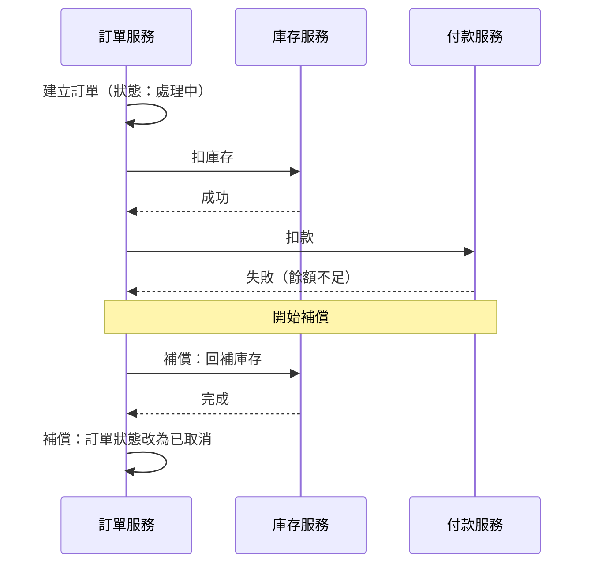

# 10. 分散式系統

> **一句話**：一台機器時「呼叫函式」必定有結果；多台機器時，網路可能延遲、斷線、重複，**你永遠無法確定對方到底有沒有做**。

## 學習目標

- 解釋為什麼「逾時不等於失敗」以及重試必須搭配冪等
- 用 CAP 定理說明 CP 與 AP 的取捨
- 比較 2PC 與 Saga，並說明補償動作
- 實作帶過期時間的分散式鎖並說出注意事項

---

## 1. 分散式系統的根本難題 🟡

### 1.1 網路不可靠

常見錯誤假設：網路永遠可靠、延遲為零、頻寬無限、拓撲不變。實際上這些都不成立。

### 1.2 逾時不等於失敗（最重要）

你呼叫付款服務，等了 5 秒沒回應：
- 可能請求根本沒送到
- 可能對方處理成功了，只是回應丟失
- 可能對方還在處理中

→ **所以重試必須搭配冪等**，否則可能重複扣款。

## 2. CAP 定理（面試必考）🟡

分散式系統有三個期望：
- **C（Consistency，一致性）**：每次讀到的都是最新資料
- **A（Availability，可用性）**：每個請求都會得到回應
- **P（Partition tolerance，分區容錯）**：網路斷開時系統仍運作

**重點：網路分區一定會發生，所以 P 必選。真正的抉擇是「斷線時，要保 C 還是保 A」。**

| 選擇 | 斷線時行為 | 例子 |
|---|---|---|
| **CP** | 寧可拒絕服務，也不回傳可能錯的資料 | 銀行帳務、庫存、分散式鎖（etcd、ZooKeeper） |
| **AP** | 先回應（可能是舊資料），之後再同步 | 社群按讚數、商品瀏覽數、購物車（DynamoDB、Cassandra） |

## 3. 一致性的程度 🟡

- **強一致性**：寫入後，所有人立刻讀到新值。簡單好懂，但慢。
- **最終一致性**：寫入後，過一小段時間所有人才會讀到新值。快、可擴展，但程式要能容忍短暫不一致。

> 實務：**錢、庫存用強一致；統計、通知、推薦用最終一致。**
> BASE（基本可用、軟狀態、最終一致）是與 ACID 相對的設計哲學。

## 4. 分散式交易 🔴

跨多個服務 / 資料庫，怎麼保證「全成功或全失敗」？

| 方案 | 做法 | 評價 |
|---|---|---|
| **2PC（兩階段提交）** | 協調者先問所有人「能提交嗎」，都同意才提交 | 強一致，但慢、協調者掛掉會卡住，微服務少用 |
| **Saga** | 拆成多個本地交易，失敗時依序執行補償動作 | **微服務主流**，最終一致 |
| **Outbox Pattern** | 業務資料與待發訊息同一交易寫入（見[第 08 章](08-message-queue.md)） | 搭配 Saga 使用 |

**Saga 範例**：扣款失敗時，依相反順序執行補償動作。

## 5. 分散式鎖 🟡

**情境**：多台伺服器同時跑排程，只能讓一台執行；或多台同時扣同一商品庫存。

- 常用實作：**Redis**（`SET key value NX PX` 設定過期時間）、**etcd / ZooKeeper**（更可靠）
- 必須設定**過期時間**，避免持有者當機後鎖永遠不釋放
- 只能由**持有者本人**解鎖（比對值）
- 能用資料庫條件更新解決的，就不要用分散式鎖（更簡單）

## 6. 其他必懂概念 🟡

| 概念 | 重點 |
|---|---|
| **共識演算法（Raft）** | 讓多台機器對「誰是主節點、資料是什麼」達成一致。K8s 的 etcd、Kafka 都用。知道用途即可 |
| **分散式 ID** | 多台機器產生不重複 ID：UUID v7（帶時間、可排序，現行推薦）、Snowflake |
| **時鐘不可靠** | 各機器時間會有誤差，不能單靠時間戳判斷事件先後 |
| **服務發現** | 服務 IP 會變動，透過註冊中心或 K8s DNS 找到對方 |
| **一致性雜湊** | 增減節點時只需搬移少量資料（分散式快取、分片常用） |

---

## 動手練習

1. **實作 Saga**：用兩個小服務（訂單、庫存）與 RabbitMQ 實作下單流程，讓庫存扣減失敗時觸發訂單取消的補償動作。
2. **分散式鎖**：用 Redis `SET NX PX` 實作鎖，同時啟動兩個執行個體跑同一個排程，確認只有一個能執行；再故意讓工作時間超過鎖期限，觀察會發生什麼事。
3. **模擬網路逾時**：用 Toxiproxy 等工具為服務間呼叫加入延遲與斷線，觀察系統行為並加入逾時與重試。

## 面試常問

> 先試著自己回答，再對照參考解答。

### Q1. 說明 CAP 定理，你的系統選 CP 還是 AP？為什麼？

CAP：分散式系統在發生**網路分區（P）**時，**一致性（C）**與**可用性（A）**只能二選一。因為網路分區一定會發生，實際上是在 CP 與 AP 之間選擇。

- **CP**：分區時寧可拒絕請求，也不回傳可能錯誤的資料
- **AP**：分區時仍然回應，但可能是舊資料，之後再同步

回答範例：「訂單付款與庫存選 CP，因為超賣或重複扣款的代價很高；商品瀏覽數、按讚數選 AP，短暫不準確不影響使用者，可用性更重要。」重點是**依資料性質分別選擇**，而不是整個系統只有一種。

### Q2. 強一致性與最終一致性的差別與適用場景？

- **強一致性**：寫入成功後，任何人立刻讀到的都是新值。程式簡單直覺，但需要協調，延遲較高、可用性較低。
  - 適用：金額、庫存、帳號權限、唯一性檢查
- **最終一致性**：寫入後短時間內不同節點可能讀到舊值，但最終會一致。效能好、易擴展。
  - 適用：社群動態、按讚數、搜尋索引、推薦、通知、報表

設計最終一致的系統時，要讓使用者體驗能接受延遲，例如「訂單處理中」的中間狀態。

### Q3. 微服務如何做分散式交易？Saga 的補償是什麼意思？

微服務多用 **Saga** 而非 2PC：將一個跨服務的流程拆成多個**本地交易**依序執行。

**補償**：已完成的步驟無法「回滾」，因為資料已經提交，所以要執行**語意上相反的動作**來抵銷。例如：
- 扣庫存 → 補償是「加回庫存」
- 扣款 → 補償是「退款」
- 建立訂單 → 補償是「取消訂單」

補償動作本身必須**可重試且冪等**。另外要注意，執行過程中其他人可能看到中間狀態，需要用狀態欄位（如「處理中」）處理。

### Q4. 如何用 Redis 實作分散式鎖？要注意什麼？

**加鎖**：`SET lock:order:123 <唯一值> NX PX 30000`
- `NX`：key 不存在才設定成功（搶鎖）
- `PX 30000`：30 秒後自動過期，避免持有者當機造成永久鎖死
- 唯一值：例如 UUID，標示鎖的持有者

**解鎖**：用 Lua 腳本**先比對值再刪除**，確保只刪自己的鎖（避免鎖過期後誤刪別人剛拿到的鎖）。

**注意事項**：
- 業務執行時間可能超過鎖的過期時間 → 需要**續期機制**（如 Redisson 的 watchdog）
- Redis 主從切換時鎖可能遺失 → 正確性要求極高時改用 etcd / ZooKeeper，或搭配 **Fencing Token**
- 能用資料庫條件更新或唯一約束解決的，就不要用分散式鎖

### Q5. 呼叫外部服務逾時，你會怎麼處理？

先理解：**逾時不代表失敗**，對方可能已經處理成功。處理方式：
1. **一定要設定逾時**，避免執行緒被卡住
2. **確認操作是否冪等**：冪等才能安全重試；非冪等操作要帶 Idempotency-Key
3. **有限次數重試 + 指數退避 + 隨機抖動**
4. 對方持續失敗時用**熔斷器**快速失敗，保護自己
5. 無法確定結果時，**查詢對方狀態**或排程對帳，而不是盲目重做
6. 提供**降級**回應，例如顯示「處理中，稍後通知」

### Q6. 為什麼不用自增 ID 當分散式 ID？

- **多台資料庫各自自增會重複**：分庫分表後，不同庫可能產生相同 ID
- **依賴單一資料庫產生 ID 會成為瓶頸與單點故障**
- **可被猜測**：連續數字讓外部可推測資料量，或遍歷他人資料（例如 `/orders/1001` 改成 `1002`）
- 資料合併、搬移時容易衝突

替代方案：
- **UUID v7**：全域唯一、帶時間戳可排序，對資料庫索引較友善（UUID v4 完全隨機，索引效能差）
- **Snowflake**：64 位元整數，由時間戳 + 機器編號 + 序號組成，有序且高效

## 過時技術（知道就好）

- **MSDTC / XA 分散式交易**：舊式跨資料庫交易協調，雲端與微服務環境中已少用。

## 本章回顧

- 網路會失敗，逾時結果未知 → 重試 + 冪等
- CAP：分區必然發生，在 C 與 A 間擇一
- 微服務交易用 Saga，不用 2PC
