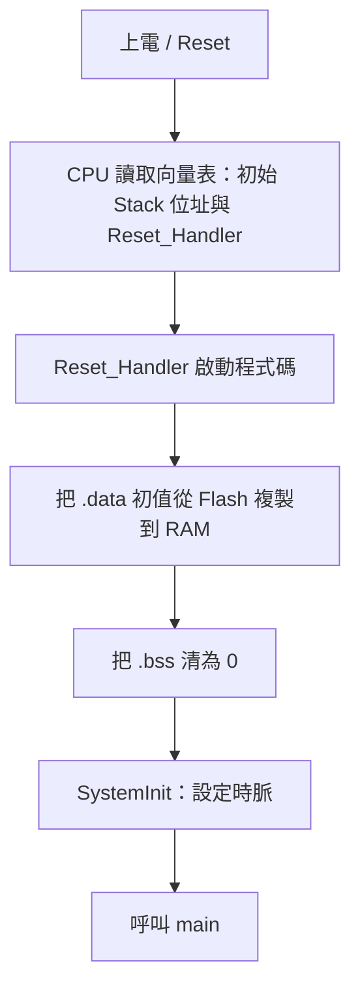

# 20. 嵌入式 C 必懂觀念

> **一句話**：韌體面試的第一關幾乎都是 C。重點不是語法，而是**程式在記憶體中長什麼樣子、編譯器會對它做什麼**。

## 學習目標

- 說明 `.text`、`.data`、`.bss`、Stack、Heap 分別放在 Flash 還是 RAM
- 正確使用 `const`、`static`、`volatile`，並解釋它們對編譯結果的影響
- 計算結構的大小與對齊，知道通訊資料為何不能直接傳結構
- 說明嵌入式系統為何避免 `malloc`，以及替代方案

---

## 1. 為什麼韌體還是用 C 🟢

- **可預測**：寫什麼大致就產生什麼機器碼，執行時間與記憶體用量容易估算
- **貼近硬體**：可以直接讀寫記憶體位址（暫存器）
- **生態**：所有晶片廠的 SDK、驅動、RTOS 都以 C 提供
- **資源極省**：沒有執行環境、沒有 GC

C++ 在中大型韌體也常見（通常不使用例外與 RTTI），Rust 則是成長中的選項。

## 2. 程式在記憶體中的位置（面試必考）🟡

| 區段 | 內容 | 位置 |
|---|---|---|
| **`.text`** | 程式碼 | Flash |
| **`.rodata`** | 常數、字串常值、`const` 全域變數 | Flash |
| **`.data`** | **有初值**的全域 / `static` 變數 | 初值存在 Flash，開機時**複製到 RAM** |
| **`.bss`** | **沒有初值（或初值為 0）**的全域 / `static` 變數 | RAM，開機時**清為 0** |
| **Heap** | `malloc` 動態配置 | RAM |
| **Stack** | 區域變數、函式呼叫資訊、中斷現場 | RAM |

### 開機到 `main()` 之前發生什麼



**實用知識**：
- 大型查表資料加上 `const`，就會放在 Flash 而不佔用寶貴的 RAM
- 編譯後的 **map 檔**記錄每個變數與函式的位置和大小，是優化記憶體的第一手資料
- 記憶體配置由 **Linker Script** 決定（Flash 與 RAM 的起始位址、大小、各區段擺放）

## 3. 三個關鍵字：const、static、volatile 🟡

### 3.1 `const`

表示「不能透過這個名稱修改」，搭配指標時要看 `const` 的位置：

| 宣告 | 意思 |
|---|---|
| `const int *p` | 指向的**值**不能改，指標可以指別處 |
| `int *const p` | **指標**不能改指別處，值可以改 |
| `const int *const p` | 兩者都不能改 |

口訣：`const` 在 `*` 左邊修飾「值」，在 `*` 右邊修飾「指標」。

### 3.2 `static` 的三種用途

1. **函式內的 `static` 變數**：只初始化一次，函式結束後值仍保留（存在 `.data` / `.bss`，不在 Stack）
2. **檔案層級的 `static` 全域變數**：只有這個 `.c` 檔看得到，達到封裝效果
3. **`static` 函式**：只能在本檔案呼叫，避免名稱衝突，也讓編譯器更容易最佳化

### 3.3 `volatile`

告訴編譯器「這個變數可能在程式看不到的地方被改變」，每次存取都要真的讀寫記憶體。

- 用於：**硬體暫存器**、**中斷與主程式共用的變數**
- **不保證原子性，也不是鎖**（[第 22 章](22-rtos-concurrency.md)）

```c
volatile bool data_ready = false;   // 中斷中設為 true

void main_loop(void) {
    while (!data_ready) { }   // 沒有 volatile，編譯器可能只讀一次，變成無窮迴圈
}
```

## 4. 指標與暫存器存取 🟡

- 暫存器就是**特定位址的記憶體**，透過指標存取：

```c
#define GPIOA_ODR (*(volatile uint32_t *)0x48000014u)
GPIOA_ODR |= (1u << 5);   // 讓 PA5 輸出高電位
```

- 晶片廠的標頭檔（ARM 的 **CMSIS**）用「結構對應暫存器區塊」的方式，讓程式寫成 `GPIOA->ODR`，可讀性更好
- **函式指標**：用於回呼（callback）、狀態機、驅動程式介面（例如同一套程式支援不同感測器）
- 常見錯誤：未初始化的指標、指向已結束函式的區域變數、陣列越界

## 5. 位元操作 🟢

韌體每天都在做的事：

| 操作 | 寫法 |
|---|---|
| 設定第 n 位為 1 | `reg \|= (1u << n);` |
| 清除第 n 位 | `reg &= ~(1u << n);` |
| 反轉第 n 位 | `reg ^= (1u << n);` |
| 檢查第 n 位 | `if (reg & (1u << n))` |
| 設定多位元欄位 | 先用遮罩清除，再寫入新值 |

注意：`reg |= x` 是**讀取 → 修改 → 寫回**三個步驟，若中斷也在改同一個暫存器，可能互相覆蓋。部分晶片提供 **BSRR（設定 / 重設暫存器）** 或 **bit-banding** 來做原子操作。

## 6. 資料型別與整數陷阱 🟡

- **用固定寬度型別**：`uint8_t`、`int16_t`、`uint32_t`（`<stdint.h>`）。`int` 在不同平台可能是 16 或 32 位元
- **整數提升**：`uint8_t` 運算時會先轉成 `int`，比較或位移時可能得到意外結果
- **有號數溢位是未定義行為**，編譯器可能做出令人意外的最佳化；需要環繞時用無號數
- **除法很慢**：沒有硬體除法器的 MCU 上，盡量用位移取代除以 2 的次方
- **浮點數**：沒有 FPU 的 MCU 上浮點運算極慢，常改用**定點數**（例如以 0.01°C 為單位存整數）

## 7. 結構對齊與填充（面試必考）🟡

CPU 存取對齊的資料最快，編譯器會在欄位間**自動補空位（padding）**：

```c
struct A { uint8_t a; uint32_t b; uint8_t c; };  // 大小 12（1 + 3 補 + 4 + 1 + 3 補）
struct B { uint32_t b; uint8_t a; uint8_t c; };  // 大小 8（4 + 1 + 1 + 2 補）
```

- **欄位由大到小排列**可減少浪費
- `__attribute__((packed))` 可取消填充，但存取未對齊的資料可能變慢，部分核心（如 Cortex-M0）甚至會觸發 **HardFault**
- **通訊資料不要直接傳結構**：不同編譯器、平台的填充與位元組序（Endian）可能不同，應**逐欄位序列化**

## 8. 動態記憶體：盡量不用 🟡

嵌入式系統避免 `malloc` / `free` 的原因：
- **碎片化**：長時間運作後，總空間足夠卻找不到連續區塊
- **執行時間不確定**，影響即時性
- **失敗難處理**：配置失敗時裝置該怎麼辦？
- 安全規範（MISRA C）禁止使用

替代方案：
- **靜態配置**：編譯時就決定所有緩衝區大小
- **記憶體池（Memory Pool）**：預先切好固定大小的區塊，配置與釋放時間固定
- 只在**初始化階段**配置一次，之後不再釋放

## 9. 編譯器最佳化與未定義行為 🔴

- 開啟最佳化（`-O2`、`-Os`）後，編譯器會刪除「看起來沒用」的程式碼。例如空的延遲迴圈會被整個刪除——所以延遲要用 Timer，不要靠迴圈
- **除錯版正常、發行版出錯**，常見原因：漏了 `volatile`、未初始化變數、未定義行為、Stack 不足
- **MISRA C**：車用等安全關鍵產業的撰寫規範，禁止容易出錯的寫法
- **靜態分析**：cppcheck、clang-tidy、商業工具（Coverity、PC-lint）

## 10. 巨集與 inline 函式 🟢

| | 巨集 `#define` | `static inline` 函式 |
|---|---|---|
| 處理時機 | 前置處理器文字替換 | 編譯器處理 |
| 型別檢查 | 無 | 有 |
| 參數求值 | **可能重複求值**（`MAX(i++, j)` 出錯） | 只求值一次 |
| 除錯 | 困難 | 可設中斷點 |

建議：**能用 `static inline` 就不用巨集**；巨集保留給常數、條件編譯與編譯期需要的情況。巨集參數與整體都要加括號。

---

## 動手練習

1. **在電腦上驗證對齊**：用 GCC 寫幾個結構並印出 `sizeof` 與 `offsetof`，調整欄位順序觀察大小變化。
2. **看記憶體區段**：編譯一個開發板專案，用 `arm-none-eabi-size` 看 `.text`、`.data`、`.bss` 大小；把一個大陣列加上 `const`，觀察 RAM 用量變化。
3. **觀察 volatile 的影響**：到 Compiler Explorer（godbolt.org）貼上「等待旗標」的迴圈，比較有無 `volatile` 在 `-O2` 下產生的組合語言。

## 面試常問

> 先試著自己回答，再對照參考解答。

### Q1. `const int *p`、`int *const p`、`const int *const p` 有什麼不同？

- `const int *p`：**指向的值**不能透過 `p` 修改，但 `p` 可以改指其他位址
- `int *const p`：**指標本身**不能改，必須在宣告時初始化，但可以修改指向的值
- `const int *const p`：指標與指向的值都不能改

判斷方法：由右往左讀，或記住「`const` 在 `*` 左邊修飾值、在右邊修飾指標」。實務上函式參數常用 `const uint8_t *buf` 表示「我只讀不改你的資料」。

### Q2. `static` 有哪些用途？

1. **函式內的區域變數**：生命週期變成整個程式執行期間，只初始化一次，值在呼叫之間保留；存放在 `.data` / `.bss`，不在 Stack
2. **檔案層級的全域變數**：限制只有本檔案可見，避免被其他檔案誤用，達到封裝
3. **函式**：限制只能在本檔案呼叫，避免名稱衝突，也有利編譯器 inline 最佳化

注意：函式內的 `static` 變數讓函式**不可重入**，在多任務或中斷中呼叫要小心。

### Q3. 全域變數的初值存在哪裡？`.data` 和 `.bss` 差在哪？

- **`.data`**：有非零初值的全域與 `static` 變數。初值存放在 **Flash**，開機時由啟動程式**複製到 RAM**，之後在 RAM 中讀寫
- **`.bss`**：沒有初值或初值為 0 的全域與 `static` 變數。**Flash 中不佔空間**，開機時直接把 RAM 中這段區域**清為 0**

所以把大陣列初值設為 0 或不設初值，不會增加 Flash 用量；而 `const` 資料只放在 Flash，不佔 RAM。

### Q4. `volatile` 的用途？用了 `volatile` 就能保護共享資料嗎？

**用途**：告訴編譯器這個變數可能被程式以外的因素改變（硬體、中斷、其他任務），每次存取都必須真的讀寫記憶體，不能快取在暫存器或被最佳化掉。用於硬體暫存器、中斷與主程式共用的旗標。

**不能保護共享資料**：`volatile` 不保證原子性。例如 `count++` 仍是「讀取 → 加一 → 寫回」三步，中斷在中間發生就可能遺失更新；在 8 位元 MCU 上讀取 32 位元變數也可能被中斷切成兩半。需要**關閉中斷的臨界區段**、原子操作指令或 RTOS 的 mutex（[第 22 章](22-rtos-concurrency.md)）。

### Q5. 如何設定、清除、反轉暫存器的某一位？

- 設定第 n 位：`reg |= (1u << n);`
- 清除第 n 位：`reg &= ~(1u << n);`
- 反轉第 n 位：`reg ^= (1u << n);`
- 檢查第 n 位：`(reg >> n) & 1u`

注意事項：
- 使用無號數 `1u`，避免有號數位移的未定義行為
- `|=` 是「讀取-修改-寫入」，若中斷也會修改同一暫存器，需要保護或改用晶片提供的原子設定暫存器（如 STM32 的 BSRR）
- 有些暫存器位元是「寫 1 清除」（W1C），不能用 `|=`，要仔細看手冊

### Q6. 下面結構的大小是多少？如何減少？

```c
struct S { uint8_t a; uint32_t b; uint16_t c; };
```

在 32 位元平台上通常是 **12 bytes**：`a` 佔 1，補 3 讓 `b` 對齊到 4 的倍數；`b` 佔 4；`c` 佔 2；最後補 2 讓整個結構大小是最大對齊（4）的倍數。

減少方式：
- **依大小排列欄位**：`uint32_t b; uint16_t c; uint8_t a;` → 4 + 2 + 1 + 補 1 = **8 bytes**
- 使用 `packed` 可降到 7 bytes，但存取未對齊資料可能變慢或在某些核心觸發 HardFault，一般只用於對應通訊格式或硬體結構

### Q7. 為什麼嵌入式系統少用 `malloc`？

- **記憶體碎片化**：長時間運作後可能出現總空間足夠卻配置失敗
- **執行時間不確定**：搜尋可用區塊的時間不固定，影響即時性
- **失敗難處理**：裝置在現場，配置失敗沒有好的復原方式
- **Heap 與 Stack 互相擠壓**，溢位不易察覺
- **安全規範**（MISRA C、功能安全標準）通常禁止

替代：靜態配置、固定大小區塊的記憶體池、只在初始化時配置一次。RTOS 也提供固定時間的配置方式（例如 FreeRTOS 的 heap_1 只配置不釋放）。

### Q8. 如何判斷 CPU 是大端還是小端？

- **小端（Little Endian）**：低位元組存在低位址。ARM Cortex-M、x86 預設皆為小端
- **大端（Big Endian）**：高位元組存在低位址。**網路位元組序**是大端

判斷方法：把 `uint32_t x = 1;` 的位址轉成 `uint8_t *` 讀第一個位元組，是 1 就是小端。

實務重點：通訊協定或檔案格式要明確規定位元組序，收發時用位移逐位元組組合或轉換函式，不要依賴平台預設。

### Q9. 巨集和 inline 函式差在哪？

- **巨集**是前置處理器的文字替換：沒有型別檢查、參數可能被**重複求值**（例如 `SQUARE(i++)`），運算子優先順序容易出錯，除錯困難
- **inline 函式**由編譯器處理：有型別檢查、參數只求值一次、可以除錯，最佳化後通常與巨集一樣快

建議用 `static inline` 取代類函式巨集；巨集保留給常數、條件編譯、需要字串化或在編譯期展開的情況。

### Q10. 程式在除錯版正常、開最佳化後就出錯，可能是什麼原因？

- 共享變數**漏了 `volatile`**，被編譯器快取或刪除
- 用空迴圈做延遲，被最佳化刪掉，時序改變
- **未定義行為**：未初始化變數、陣列越界、有號數溢位、違反嚴格別名規則
- **Stack 不足**：最佳化改變了函式 inline 與 Stack 用量
- 時序改變暴露了原本就存在的**競爭條件**

排查方式：開啟編譯警告（`-Wall -Wextra`）、靜態分析、在最佳化版本用除錯器檢查、檢查 map 檔與 Stack 用量。

## 常見誤解

- **「用 `delay()` 迴圈控制時間」**：時間不準、浪費 CPU，最佳化後還可能消失，應使用 Timer。
- **「`int` 一定是 32 位元」**：在 8 / 16 位元 MCU 上可能是 16 位元，應使用 `stdint.h` 的固定寬度型別。

## 本章回顧

- 記住記憶體地圖：`.text` / `.rodata` 在 Flash，`.data` / `.bss` / Stack / Heap 在 RAM
- `volatile` 防止最佳化，但不保證原子性
- 避免 `malloc`，結構欄位由大到小排列，通訊資料逐欄位序列化
