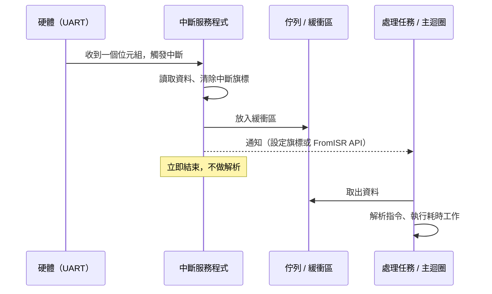
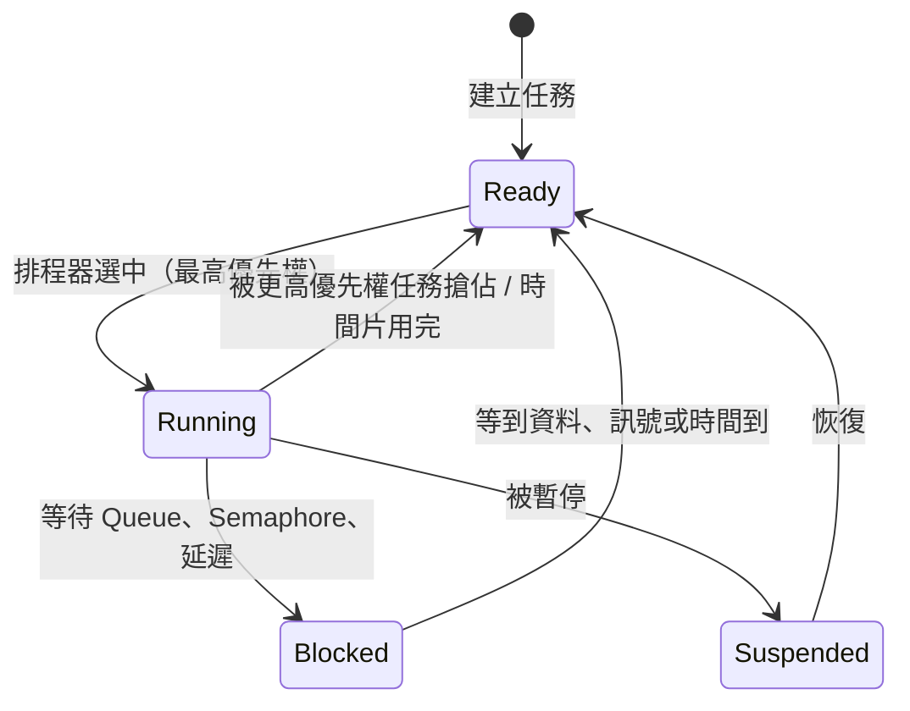
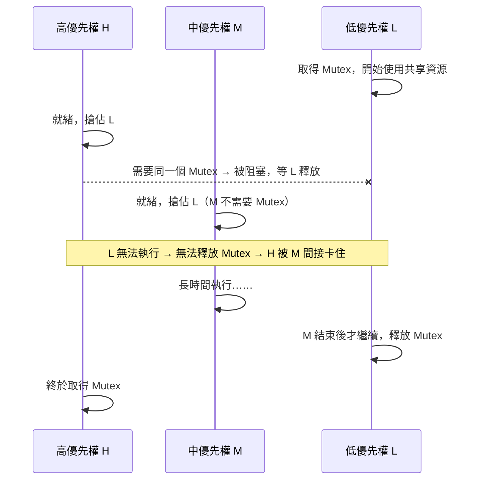

# 22. RTOS 與嵌入式併發

> **一句話**：韌體最難抓的 bug 大多來自「兩段程式同時碰到同一份資料」。中斷、任務、共享資源的觀念，和[第 01 章](01-cs-fundamentals.md)的執行緒與鎖相通，但時間要求更嚴格。

## 學習目標

- 說明中斷的運作方式與 ISR 的設計原則
- 找出中斷與主程式間的資料競爭，並用臨界區段、環形緩衝區解決
- 理解 RTOS 的任務狀態、排程與同步機制，知道何時用 Queue、Semaphore、Mutex
- 解釋優先權反轉與硬即時、軟即時的差別

---

## 1. 程式架構的演進 🟢

| 架構 | 做法 | 適合 |
|---|---|---|
| **Super Loop** | `while(1)` 依序處理所有事情 | 功能很少的簡單裝置 |
| **前後台系統** | 中斷（前台）處理緊急事件，主迴圈（後台）處理其餘工作 | 多數簡單到中等的 MCU 產品 |
| **RTOS** | 功能拆成多個任務，由排程器依優先權切換 | 功能多、時序需求不同、需要網路堆疊 |
| **嵌入式 Linux** | 完整作業系統（[第 24 章](24-embedded-linux.md)） | 複雜功能、豐富套件 |

## 2. 中斷 🟡

**中斷**：硬體事件（計時器到期、收到資料、按鍵）發生時，CPU 暫停目前工作，跳到對應的**中斷服務程式（ISR）**，處理完再回來。

- **向量表**：記錄每種中斷對應的 ISR 位址
- **NVIC**（Cortex-M 的中斷控制器）：管理致能與**優先權**，高優先權中斷可以打斷低優先權中斷（巢狀中斷）
- **中斷延遲（Latency）**：從事件發生到 ISR 開始執行的時間，即時系統要能估算上限

### ISR 設計原則：只做最少的事

這種「ISR 收資料、任務做處理」的分工稱為**上半部 / 下半部**設計。

## 3. 共享資料與競爭條件 🟡

### 3.1 問題從哪裡來

- 主程式執行 `count++`（讀取 → 加一 → 寫回）到一半，中斷也修改了 `count` → **其中一次更新遺失**
- 8 位元 MCU 讀取 32 位元變數需要多次存取，中間被中斷修改 → **讀到一半新、一半舊的值**

`volatile` 只能防止編譯器最佳化，**解決不了這兩個問題**。

### 3.2 解法

| 方法 | 說明 | 注意 |
|---|---|---|
| **臨界區段** | 存取共享資料前暫時關閉中斷，存取完再開啟 | 關中斷時間要極短，否則影響即時性 |
| **原子操作** | 使用 CPU 提供的原子指令（如 Cortex-M 的 LDREX/STREX、C11 `stdatomic.h`） | 依平台支援 |
| **單一寫入者設計** | 每份資料只由一方寫入 | 搭配環形緩衝區 |
| **RTOS 同步機制** | Mutex、Queue | **不能在 ISR 中等待 Mutex** |

### 3.3 環形緩衝區（Ring Buffer）

中斷與主程式交換資料最常用的結構：固定大小陣列加上**寫入索引**與**讀取索引**。
- ISR 只修改寫入索引，主程式只修改讀取索引 → **單一生產者、單一消費者時不需要關中斷**
- 大小設為 2 的次方，可用位元遮罩取代取餘數運算
- 必須處理**滿了**的情況（丟棄新資料或覆蓋舊資料）

### 3.4 可重入函式

**可重入**：函式執行到一半被中斷，中斷又呼叫同一個函式，兩次執行都能得到正確結果。
- 條件：只使用區域變數與參數，不使用全域 / `static` 變數，不呼叫不可重入的函式
- 常見不可重入：使用靜態緩衝區的函式、部分標準函式庫（如 `strtok`）、`malloc`

## 4. RTOS 核心觀念 🟡

### 4.1 任務狀態

- **搶佔式優先權排程**：最高優先權的就緒任務一定先執行
- **Tick**：系統定時中斷（常見 1ms），用於延遲與逾時計算
- **每個任務有自己的 Stack**，大小要規劃，太小會溢位、太大浪費 RAM
- 任務等待時進入 **Blocked**，不佔 CPU；所有任務都 Blocked 時執行 Idle 任務，可進入低功耗模式

### 4.2 同步機制怎麼選

| 機制 | 用途 | 例子 |
|---|---|---|
| **Queue（佇列）** | 任務間或 ISR → 任務**傳遞資料** | UART 收到的資料交給解析任務 |
| **Binary Semaphore** | **事件通知**（ISR 通知任務「有事發生」） | 按鍵中斷喚醒處理任務 |
| **Counting Semaphore** | 計數事件或管理 N 個相同資源 | 3 個可用緩衝區 |
| **Mutex** | **保護共享資源**，有擁有者概念，支援優先權繼承 | 多個任務共用 SPI 匯流排或 printf |
| **Event Group** | 等待多個事件的組合 | Wi-Fi 已連線**且**時間已同步 |
| **Task Notification**（FreeRTOS） | 輕量的一對一通知 | 取代 Binary Semaphore，更快更省記憶體 |

## 5. 優先權反轉（面試必考）🔴

**解法：優先權繼承**——L 持有 H 需要的 Mutex 時，暫時提升 L 到 H 的優先權，M 就無法插隊。（1997 年火星探路者號反覆重開機就是此問題，最後遠端開啟優先權繼承修復。）

## 6. 即時性 🟡

| | 硬即時（Hard Real-Time） | 軟即時（Soft Real-Time） |
|---|---|---|
| 錯過期限 | **系統失效**，可能造成危險 | 品質下降，但仍可接受 |
| 例子 | 安全氣囊、馬達控制、煞車 | 影音播放、UI 反應 |

- **即時 ≠ 快**，而是**可預測**：最壞情況執行時間（WCET）也必須在期限內
- **抖動（Jitter）**：每次執行時間的變動，越小越好
- 影響即時性的因素：關中斷時間過長、優先權設計不當、動態記憶體、快取

## 7. 主流 RTOS 🟢

| RTOS | 特色 |
|---|---|
| **FreeRTOS** | 最普及、輕量、文件與範例多，AWS 維護 |
| **Zephyr** | Linux 基金會主導，內建大量驅動與網路 / 藍牙堆疊，使用 Devicetree 與 Kconfig（觀念同 Linux），業界快速採用 |
| **Eclipse ThreadX** | 原 Azure RTOS，已開源，具安全認證 |
| **RT-Thread** | 中國開源 RTOS，元件豐富 |

---

## 動手練習

1. **重現競爭條件**：主迴圈和計時器中斷同時對一個計數器加一，執行一段時間後比對理論值與實際值；再加上臨界區段比較。
2. **實作環形緩衝區**：UART 中斷收資料放入環形緩衝區，主迴圈取出並回傳（Echo），測試大量資料時是否遺失。
3. **FreeRTOS 三任務**：建立感測、通訊、LED 三個任務，以 Queue 傳遞感測資料；用 `uxTaskGetStackHighWaterMark` 檢查各任務 Stack 用量。
4. **觀察優先權反轉**：建立 H / M / L 三個任務重現優先權反轉，先用 Binary Semaphore（無優先權繼承）再換成 Mutex，比較 H 的等待時間。

## 面試常問

> 先試著自己回答，再對照參考解答。

### Q1. 中斷處理程式為什麼要短？可以在裡面做什麼、不能做什麼？

**為什麼要短**：中斷執行時會打斷主程式，並可能**阻擋同級或更低優先權的中斷**。處理太久會造成其他中斷延遲或遺失、系統即時性變差。

**可以做**：
- 讀取硬體資料、清除中斷旗標
- 把資料放入緩衝區或佇列
- 設定旗標或通知 RTOS 任務（使用 ISR 專用 API，例如 FreeRTOS 的 `xQueueSendFromISR`）

**不應該做**：
- 長時間運算、延遲等待（`delay`）、迴圈輪詢
- `printf` 等慢速 I/O
- 動態記憶體配置（`malloc`）
- 呼叫會阻塞的函式或取得 mutex

原則：**ISR 只做最少的事，其他交給主迴圈或任務處理**（上半部 / 下半部設計）。

### Q2. 什麼是優先權反轉？怎麼解決？

**情境**：低優先權任務 L 持有一個 mutex，高優先權任務 H 需要這個 mutex 而等待。此時中優先權任務 M 就緒並搶佔 L，導致 L 無法執行、無法釋放 mutex → **H 被 M 間接卡住**，優先權順序被反轉。（著名案例：1997 年火星探路者號反覆重開機。）

**解法**：
- **優先權繼承**：L 持有 H 需要的鎖時，暫時把 L 提升到 H 的優先權，盡快執行完並釋放（FreeRTOS 的 mutex 支援）
- **優先權天花板**：鎖本身設定一個最高優先權，任何取得它的任務都暫時提升到該等級
- 設計上**縮短持鎖時間**，避免高低優先權任務共用資源

### Q3. 主程式與中斷共用一個變數，加上 `volatile` 就安全了嗎？

不夠。`volatile` 只確保每次都真的讀寫記憶體，**不保證原子性**：
- `count++` 是讀取、加一、寫回三步，中斷在中間修改會造成更新遺失
- 在 8 / 16 位元 MCU 上存取 32 位元變數需要多條指令，可能讀到被中斷修改了一半的值

正確做法：
- 存取時用**臨界區段**（短暫關閉中斷）
- 使用**原子操作**指令
- 設計成**單一寫入者**，例如環形緩衝區的讀寫索引各由一方修改
- 仍需搭配 `volatile`，確保編譯器不會快取變數

### Q4. Mutex 和 Binary Semaphore 差在哪？

| | Mutex | Binary Semaphore |
|---|---|---|
| 用途 | **保護共享資源**（互斥） | **事件通知 / 同步** |
| 擁有者 | 有，**只有取得者能釋放** | 無，任何任務或 ISR 都能 give |
| 優先權繼承 | 支援，可避免優先權反轉 | 不支援 |
| 可在 ISR 使用 | 不可以 | 可以（give 端） |

簡記：保護資源用 Mutex，「通知有事發生」用 Semaphore（或更輕量的 Task Notification）。

### Q5. 什麼是可重入函式？為什麼重要？

**可重入函式**：執行到一半被打斷，同一個函式被另一個執行流程（中斷或其他任務）呼叫，兩次執行都不會互相影響、結果都正確。

條件：
- 只使用**參數與區域變數**
- 不修改全域或 `static` 變數（或有適當保護）
- 不呼叫不可重入的函式（如使用靜態緩衝區的函式、`malloc`、部分 `printf` 實作）

重要性：在中斷與多任務環境中，被多方呼叫的函式若不可重入，會產生難以重現的錯誤資料。

### Q6. 硬即時和軟即時的差別？

- **硬即時**：錯過期限就等於**系統失效**，可能造成安全問題。例：安全氣囊、煞車控制、馬達換相
- **軟即時**：偶爾錯過期限只會**降低品質**，系統仍可運作。例：影片播放掉幀、UI 稍慢

重點：即時不代表「快」，而是**可預測**——最壞情況的執行時間也必須在期限內。設計硬即時系統要分析最壞執行時間（WCET）、中斷延遲與排程可行性。

### Q7. 如何決定 RTOS 任務的 Stack 大小？如何偵測溢位？

**決定大小**：
- 先給較寬裕的值，實際執行所有功能路徑後，用 RTOS 提供的工具量測**最高水位**（FreeRTOS 的 `uxTaskGetStackHighWaterMark`），再保留 20～50% 餘裕
- 注意大型區域陣列、遞迴、`printf` 類函式、浮點運算都會大量使用 Stack
- 也可用編譯器產生的 Stack 用量報告（GCC `-fstack-usage`）估算

**偵測溢位**：
- RTOS 的 Stack 溢位檢查（FreeRTOS `configCHECK_FOR_STACK_OVERFLOW`）
- 在 Stack 底部寫入特定標記值（Canary），定期檢查是否被覆蓋
- 使用 MPU（記憶體保護單元）在 Stack 邊界設定保護區，溢位時立即觸發例外

### Q8. 什麼時候用 Super Loop，什麼時候導入 RTOS？

**Super Loop（加中斷）適合**：功能少、時序需求單純、資源極有限、需要最容易驗證的產品。

**導入 RTOS 的訊號**：
- 多個功能各有不同的時序需求，主迴圈越來越難安排
- 某個功能耗時較長，拖慢其他需要即時反應的功能
- 需要網路、藍牙、USB、檔案系統等通常以 RTOS 為基礎的中介軟體
- 團隊規模變大，需要更清楚的模組邊界

代價：RTOS 增加 RAM 用量（每個任務都要 Stack）、學習成本，以及死結、優先權反轉等新問題。

## 常見誤解

- **「優先權越高越好」**：把所有任務都設高優先權等於沒有優先權；應依時限要求分配，最緊急、執行最短的任務最高。
- **「用 delay 讓出 CPU 就好」**：任務應等待事件（Queue、Semaphore）而不是固定延遲輪詢，才能即時反應又省電。

## 本章回顧

- ISR 越短越好，資料交給任務處理
- `volatile` 不等於執行緒安全，共享資料要用臨界區段、原子操作或單一寫入者設計
- 保護資源用 Mutex，事件通知用 Semaphore / Notification，傳資料用 Queue
