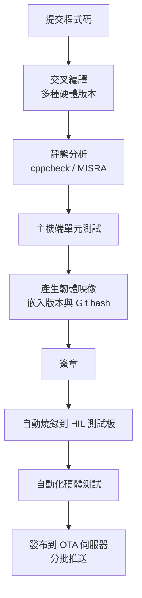
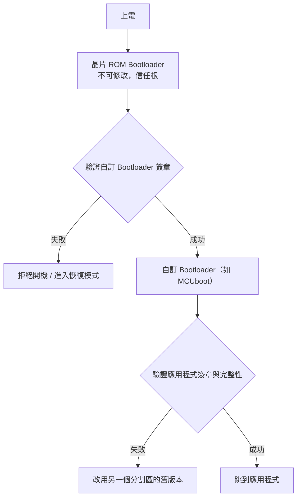
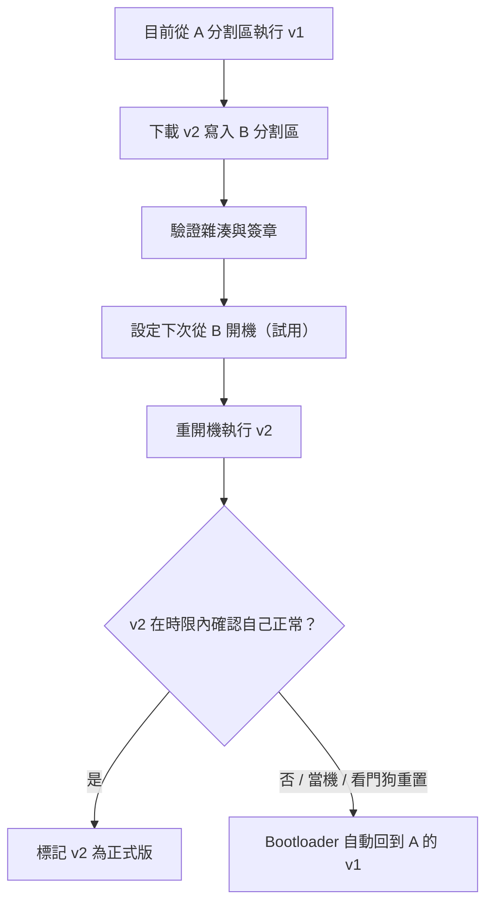

# 23. 韌體除錯、測試與量產

> **一句話**：韌體上線後裝置在客戶手上，無法隨時登入查看。**能不能快速找到問題、安全地更新、證明產品安全**，決定了韌體工程師的價值。

## 學習目標

- 使用除錯器、示波器、邏輯分析儀定位問題，並能分析 HardFault
- 設計可在電腦上執行的韌體單元測試，了解 HIL 與韌體 CI
- 說明 Bootloader、Secure Boot、OTA A/B 更新如何避免變磚與被竄改
- 認識 CRA 等資安法規對韌體開發的影響

---

## 1. 除錯工具 🟢

| 工具 | 用途 |
|---|---|
| **除錯器（J-Link、ST-Link）+ GDB / IDE** | 透過 **JTAG / SWD** 介面設中斷點、單步執行、讀寫記憶體與暫存器 |
| **Watchpoint（資料中斷點）** | 某個變數被寫入時停下——抓「誰改了我的變數」最有效 |
| **SWO / RTT 日誌** | 透過除錯介面輸出日誌，比 UART `printf` 快且不太影響時序 |
| **萬用電表** | 量電壓、檢查是否斷路短路 |
| **示波器** | 看**類比波形**：電壓高低、雜訊、上升時間、電源是否穩定 |
| **邏輯分析儀** | 同時看多條**數位訊號**，並可**解碼** UART / I²C / SPI 的內容 |

**判斷是軟體還是硬體問題**：先量測訊號是否如預期——腳位有沒有輸出、時序對不對、電壓是否正常。

## 2. 常見問題與排查 🟡

| 症狀 | 常見原因 | 排查方向 |
|---|---|---|
| **HardFault** | 空指標、存取非法位址、未對齊存取、除以零、Stack 溢位、執行到非法指令 | 讀取故障狀態暫存器與當時的 PC（下節） |
| 隨機當機 / 重開機 | Stack 溢位、看門狗逾時、電源不穩（欠壓重置） | 檢查重置原因暫存器、Stack 水位、電源波形 |
| **加了 printf 就好了** | 時序相關的競爭條件、未初始化變數 | 改用不影響時序的方式記錄（RTT、記憶體緩衝區），檢查共享資料保護 |
| 除錯版正常、發行版異常 | 漏 `volatile`、未定義行為、最佳化刪掉延遲迴圈 | [第 20 章](20-embedded-c.md) Q10 |
| 通訊偶爾失敗 | 鮑率誤差、上拉電阻、雜訊、時序 | 邏輯分析儀抓波形對照規格 |

### HardFault 分析（Cortex-M）

1. 進入 HardFault 時，CPU 已把當時的暫存器（含 **PC：出錯指令位址**、**LR**）自動存到 Stack
2. 在 HardFault 處理函式中取出這些值，並讀取**故障狀態暫存器**（CFSR、HFSR）與**錯誤位址暫存器**（MMFAR、BFAR）
3. 用 PC 對照 **map 檔或反組譯**，找到出錯的程式碼行
4. 依 CFSR 判斷類型：非法記憶體存取、未對齊、除以零、未定義指令……

**現場故障記錄**：把故障資訊寫入重開機後不會被清除的 RAM 區域或 Flash，下次開機上傳，等於韌體版的「錯誤日誌」。

## 3. 測試策略 🟡

韌體也適用[第 03 章](03-engineering-practices.md)的測試金字塔，只是多了硬體這一層：

| 層級 | 做法 | 工具 |
|---|---|---|
| **主機端單元測試** | 商業邏輯在電腦上編譯執行，硬體相關部分用假實作取代 | Unity / Ceedling、CppUTest、GoogleTest |
| **模擬器測試** | 在模擬的 MCU 上跑韌體 | QEMU、Renode |
| **HIL（硬體迴圈測試）** | 真實開發板接上測試設備，自動送訊號、量測輸出 | 自建治具 + Python 腳本、商業 HIL 設備 |
| **產線測試** | 每台出貨產品的功能檢查 | 測試治具、ATE |

**讓韌體可測試的關鍵：硬體抽象層（HAL）**——商業邏輯只呼叫介面（例如 `sensor_read()`），不直接碰暫存器。測試時替換成假實作，與 .NET 中注入 Mock 的概念相同。

## 4. 韌體 CI/CD 🟡

- 韌體映像內嵌**版本號與 Git commit hash**，現場回報問題時才能對應原始碼
- 保存每個版本的 **ELF 與 map 檔**，日後分析 HardFault 位址需要它們
- 建置環境容器化（Docker），確保任何人建出的映像完全相同

## 5. 可靠性設計 🟡

- **看門狗**：程式卡死時自動重置。只在確認所有任務都正常時才餵狗
- **欠壓偵測（Brown-out Detection）**：電壓過低時主動重置，避免在不穩定電壓下寫壞 Flash
- **重置原因記錄**：開機時讀取重置原因暫存器（看門狗、欠壓、軟體重置、外部重置）
- **失效安全（Fail-safe）**：發生錯誤時進入安全狀態，例如馬達停止、閥門關閉

## 6. 開機流程、Bootloader 與 Secure Boot 🔴

**Secure Boot（信任鏈）**：每一階段在交出控制權前，先用**公鑰驗證**下一階段的數位簽章。私鑰只存在於簽章伺服器，裝置內只有公鑰（或其雜湊），所以攻擊者無法植入自己的韌體。

其他安全措施：
- **鎖住除錯介面**（如 STM32 的 RDP），避免被讀出韌體或植入程式
- **安全元件**或 **TrustZone-M** 保護金鑰
- 韌體加密，防止被逆向工程

## 7. OTA 更新 🔴

- **差分更新**：只傳送新舊版本的差異，節省頻寬與電量
- **分批推送**：先更新少量裝置觀察，類似[第 14 章](14-cicd-devops.md)的金絲雀部署
- 常用方案：MCUboot、晶片廠 SDK 內建 OTA；嵌入式 Linux 見[第 24 章](24-embedded-linux.md)

## 8. 資安法規與標準 🔴

| 法規 / 標準 | 範圍 | 對韌體的要求 |
|---|---|---|
| **歐盟網路韌性法案（CRA）** | 在歐盟銷售的連網產品 | 漏洞通報義務自 2026 年 9 月起適用，全面適用於 2027 年 12 月；要求安全預設設定、安全更新、**SBOM**、漏洞處理流程 |
| **IEC 62443** | 工業控制系統 | 安全開發流程與產品安全等級 |
| **ISO/SAE 21434** | 車用資安 | 威脅分析與風險評估（TARA） |
| **ISO 26262** | 車用功能安全 | 依風險等級（ASIL）要求開發流程、測試與追溯 |
| **IEC 61508** | 一般功能安全 | 安全完整性等級（SIL） |

趨勢：**資安從「加分」變成「上市門檻」**，懂 Secure Boot、OTA、SBOM 與漏洞管理的韌體工程師需求持續增加。

## 9. 量產相關 🟢

- **燒錄**：產線使用燒錄器或治具批次寫入
- **個別資料寫入**：序號、MAC 位址、校正參數、裝置憑證
- **版本管理**：每批出貨的韌體版本、硬體版本對應紀錄
- **產線測試韌體**與正式韌體分開，出貨前確認已切換並鎖住除錯介面

---

## 動手練習

1. **製造並分析 HardFault**：故意寫入非法位址觸發 HardFault，在處理函式中印出 PC 與 CFSR，再用 map 檔或 `addr2line` 找到出錯行。
2. **主機端單元測試**：把感測器資料轉換邏輯抽成純函式，用 Unity 或 GoogleTest 在電腦上測試，並放進 GitHub Actions。
3. **體驗 OTA**：在 ESP32 上用官方 OTA 範例實作 A/B 更新，故意推送會當機的版本，確認能自動回滾。
4. **讀重置原因**：開機時印出重置原因，分別測試按 Reset 鍵、看門狗逾時、軟體重置。

## 面試常問

> 先試著自己回答，再對照參考解答。

### Q1. 遇到 HardFault，你會怎麼排查？

1. 在 HardFault 處理函式中取出例外發生時自動壓入 Stack 的暫存器，特別是 **PC**（出錯指令位址）與 **LR**
2. 讀取**故障狀態暫存器**（CFSR、HFSR）判斷類型，並讀取 MMFAR / BFAR 取得出錯的存取位址
3. 用 **map 檔、`addr2line` 或反組譯**把 PC 對應到原始碼行
4. 依類型判斷：空指標或非法位址存取、未對齊存取、除以零、Stack 溢位、函式指標錯誤
5. 若是偶發問題，把故障資訊存到不會被清除的記憶體，重開機後讀出分析

### Q2. 如何偵測 Stack 溢位？

- 在 Stack 底部填入特定標記值（Canary / 塗色），定期或在任務切換時檢查是否被覆蓋
- 使用 RTOS 內建檢查（FreeRTOS `configCHECK_FOR_STACK_OVERFLOW`）與水位查詢
- 使用 **MPU** 在 Stack 底部設定不可存取的保護區，溢位時立即觸發例外
- 部分新核心（Cortex-M33 等）有 Stack 上限暫存器（MSPLIM / PSPLIM）可硬體偵測
- 開發時用編譯器 `-fstack-usage` 分析各函式 Stack 用量

### Q3. 韌體高度依賴硬體，要怎麼寫單元測試？

關鍵是**把硬體存取與商業邏輯分開**：
1. 建立**硬體抽象層（HAL）**介面，例如 `gpio_write()`、`i2c_read()`
2. 商業邏輯只呼叫這些介面，不直接操作暫存器
3. 測試時連結到**假實作（Fake / Mock）**，在電腦上編譯執行
4. 用 Unity / CppUTest / GoogleTest 撰寫測試，放進 CI 自動執行

硬體驅動本身則用模擬器或 HIL 測試補足。這與軟體開發中透過依賴注入替換資料庫的做法是相同的原則。

### Q4. OTA 更新失敗時如何避免裝置變磚？

- **A/B 雙分割區**：新韌體寫入未使用的分割區，舊版本保持完整；寫入並驗證成功後才切換開機目標
- **完整性與簽章驗證**：下載後檢查雜湊與數位簽章，損壞或被竄改就拒絕安裝
- **開機確認與自動回滾**：新版開機後須在時限內「確認自己正常」，否則由 Bootloader 或看門狗自動回到舊版（例如 MCUboot 的 test / confirm 機制）
- **斷電保護**：任何時間點斷電都不會破壞目前可用的版本
- **保留安全的 Bootloader**：Bootloader 本身不透過一般 OTA 更新，確保永遠能進入恢復模式
- **分批推送**：先更新少量裝置觀察，類似金絲雀部署

### Q5. 看門狗的用途？使用時要注意什麼？

**看門狗（Watchdog Timer）**是一個硬體計時器，程式必須**定期「餵狗」（重設計時器）**；若程式卡死、陷入無窮迴圈或當機而沒有按時餵狗，計時器到期就會**自動重置系統**，讓裝置從異常狀態恢復。

使用要點：
- 在**確認系統健康**的地方餵狗，例如主迴圈或監控任務確認所有任務都正常回報後才餵，而不是在中斷中無條件餵狗
- 重置後記錄原因，方便追查問題
- 長時間操作（如抹除 Flash）前要考慮逾時時間
- 現場無人維護的裝置（IoT、工控）尤其重要

概念類似 K8s 的 Liveness Probe：偵測到不健康就重啟。

### Q6. Secure Boot 的原理是什麼？

建立**信任鏈**：
1. 晶片內不可修改的 **ROM 程式**是信任根（Root of Trust），內含或可讀取**公鑰雜湊**（通常燒在 OTP / eFuse 中）
2. 每一階段執行下一階段前，先用公鑰**驗證其數位簽章**
3. 驗證失敗就拒絕執行或進入恢復模式
4. 韌體由廠商用**私鑰簽章**，私鑰只保存在安全的簽章伺服器或 HSM，不放在裝置上

效果：攻擊者即使能寫入 Flash，也無法讓裝置執行未經簽章的韌體。通常搭配**鎖住除錯介面**與**防降版（Anti-rollback）**，避免被刷回有漏洞的舊版。

### Q7. 示波器和邏輯分析儀怎麼選？

- **示波器**：看訊號的**類比細節**——實際電壓、雜訊、上升時間、振鈴、電源漣波。通道少（常見 2～4 個）
- **邏輯分析儀**：只判斷 0 / 1，但能**同時看很多通道、長時間記錄，並解碼通訊協定**（UART、I²C、SPI、CAN）

選擇：要確認「通訊內容與時序」用邏輯分析儀；懷疑「訊號品質或電源問題」用示波器。很多問題兩者並用：先用邏輯分析儀發現錯誤的位元，再用示波器確認是否為訊號品質造成。

### Q8. 程式加了 printf 之後 bug 就消失了，可能是什麼原因？

這類問題稱為 **Heisenbug**，觀察行為本身改變了問題。常見原因：
- **時序相關的競爭條件**：printf 很慢，改變了中斷與任務的執行時間點，剛好避開競爭
- **未初始化的變數或 Stack 內容**：printf 改變了 Stack 使用方式，讓殘留值剛好正確
- **編譯器最佳化行為改變**：漏了 `volatile` 的變數因為 printf 而被重新讀取

處理方式：改用不影響時序的觀察方式（記錄到 RAM 緩衝區、RTT、切換 GPIO 腳位用邏輯分析儀觀察），並檢查共享資料保護與變數初始化。

### Q9. 歐盟 CRA 對韌體開發有什麼影響？

**CRA（網路韌性法案）**要求在歐盟銷售的連網產品符合資安要求：漏洞通報義務自 2026 年 9 月起適用，全面適用於 2027 年 12 月。對韌體開發的影響：
- **安全設計與預設設定**：例如不得使用共用的預設密碼
- **安全更新**：產品支援期間需能提供安全更新，OTA 與 Secure Boot 幾乎成為必備
- **SBOM**：列出韌體使用的所有開源與第三方元件
- **漏洞管理**：持續監控元件漏洞，並在期限內通報被積極利用的漏洞
- **文件與流程**：需要可證明的安全開發流程

對台灣出口導向的廠商影響很大，熟悉這些要求是韌體工程師的加分項。

## 常見誤解

- **「只靠 printf 除錯」**：會改變時序，且無法看到暫存器與記憶體；應善用除錯器、Watchpoint 與量測工具。
- **「韌體只能手動燒錄測試」**：交叉編譯、單元測試、HIL 都能自動化，現代韌體團隊越來越重視 CI。

## 本章回顧

- 先量測確認是軟體還是硬體問題，HardFault 從 PC 與故障暫存器追起
- 用硬體抽象層讓韌體可在電腦上單元測試
- Secure Boot 防竄改、A/B OTA 防變磚，資安法規正在成為上市門檻
