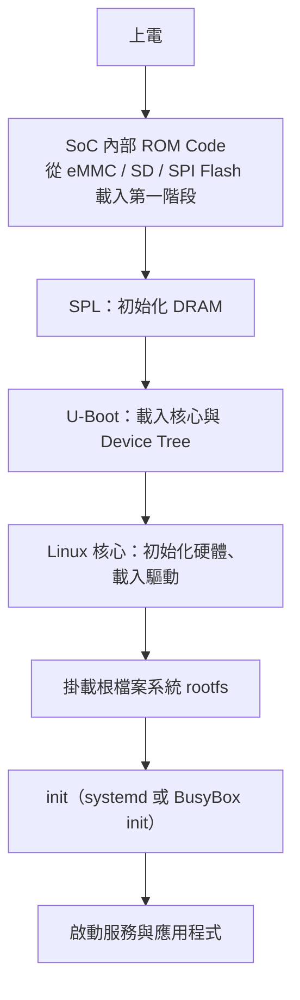

# 24. 嵌入式 Linux

> **一句話**：路由器、閘道器、車機、伺服器的 BMC 都在跑 Linux。嵌入式 Linux 讓你能用熟悉的 Linux 工具開發，但要額外理解**開機流程、核心與驅動、以及如何把整套系統打包成映像**。

## 學習目標

- 說明嵌入式 Linux 從上電到應用程式啟動的完整流程
- 區分核心空間與使用者空間，理解 Device Tree 與驅動程式的關係
- 比較 Buildroot 與 Yocto，知道如何建置與更新整個系統
- 知道在使用者空間存取 GPIO、I²C、SPI 的方法

---

## 1. 什麼時候選 Linux 🟢

| 需求 | 選 Linux 的理由 |
|---|---|
| 完整網路功能 | TCP/IP、防火牆、VPN、Web 伺服器都是現成的 |
| 圖形介面 | Qt、Wayland、瀏覽器引擎 |
| 豐富套件 | 可用 Python、Node.js、資料庫等現成軟體 |
| 多核心高效能 | Cortex-A、x86 處理器 |

代價：開機時間較長（數秒到數十秒）、需要較多記憶體與儲存、即時性較弱、系統更新與安全維護工作量大。

## 2. 開機流程 🟡

- **U-Boot**：嵌入式最常用的 Bootloader，也提供命令列可手動載入映像、設定開機參數、更新韌體
- **核心參數（bootargs）**：指定 console、根檔案系統位置等
- 開機問題排查：先看**序列埠 console 輸出**卡在哪個階段

## 3. 核心空間 vs 使用者空間 🟡

| | 核心空間（Kernel Space） | 使用者空間（User Space） |
|---|---|---|
| 權限 | 最高，可直接存取硬體 | 受限，需透過系統呼叫請求核心 |
| 錯誤影響 | 一個錯誤可能讓整個系統當機（Kernel Panic） | 只有該程序崩潰 |
| 內容 | 排程、記憶體管理、檔案系統、**驅動程式** | 應用程式、服務、函式庫 |
| 開發 | C（Rust 支援逐步擴大），除錯較困難 | 任何語言，除錯容易 |

**原則**：能在使用者空間做的就不要放進核心——開發、除錯、更新都比較容易。

## 4. Device Tree 🟡

**問題**：同一份核心要支援上千種不同的電路板，硬體資訊不應寫死在程式碼裡。

**Device Tree（裝置樹）**是一份描述硬體的資料檔：
- 有哪些周邊、暫存器位址、中斷編號
- 哪個 I²C 匯流排上接了什麼感測器、位址多少
- GPIO 與腳位複用設定

核心開機時讀取 Device Tree，依據 `compatible` 字串**配對對應的驅動程式**。換電路板通常只需修改 Device Tree，不必改驅動。

**Device Tree Overlay**：在執行時套用局部修改（例如樹莓派加裝擴充板）。

> Zephyr RTOS 也採用相同的 Devicetree 概念（[第 22 章](22-rtos-concurrency.md)）。

## 5. 驅動程式與硬體存取 🟡

### 5.1 驅動程式基本觀念

- **核心模組**：驅動可編譯成模組，執行時用 `modprobe` 載入，不必重新編譯核心
- **字元裝置**：透過 `/dev/xxx` 以讀寫檔案的方式存取（「一切皆檔案」）
- **Platform Driver**：配合 Device Tree，描述 SoC 內建周邊的驅動
- **sysfs**（`/sys`）：查看與設定裝置屬性
- 中斷處理同樣分**上半部**（快速處理）與**下半部**（workqueue、threaded IRQ）

### 5.2 從使用者空間存取硬體

| 硬體 | 現行方式 |
|---|---|
| **GPIO** | **libgpiod**（`gpioset`、`gpioget` 指令或函式庫）；舊的 `/sys/class/gpio` 介面已不建議使用 |
| **I²C** | `i2c-dev` 驅動 + `i2c-tools`（`i2cdetect` 掃描匯流排上的裝置） |
| **SPI** | `spidev` 驅動 |
| **UART** | `/dev/ttyS*`、`/dev/ttyUSB*` |

## 6. 建置系統 🟡

嵌入式 Linux 需要**交叉編譯**：在 x86 電腦上產生 ARM 執行檔，並打包成完整的系統映像。

| | Buildroot | Yocto Project |
|---|---|---|
| 定位 | 簡單、快速產生精簡系統 | 業界標準，適合長期維護的產品線 |
| 學習曲線 | 低 | 高 |
| 結構 | 單一設定（menuconfig） | **Layer（層）** 架構，BitBake 建置 recipe |
| 套件管理 | 無，整個映像重建 | 可產生套件，支援多產品共用 |
| 適合 | 小團隊、單一產品、原型 | 大型產品、多硬體平台、晶片廠 BSP |

- **BSP（Board Support Package）**：晶片廠提供的核心、Bootloader、驅動與 Device Tree，通常以 Yocto Layer 形式提供
- 網通設備常用 **OpenWrt**；伺服器 BMC 使用以 Yocto 為基礎的 **OpenBMC**（[第 25 章](25-bios-uefi-bmc.md)）

## 7. 儲存、檔案系統與更新 🟡

- 儲存：eMMC（最常見）、NAND Flash（使用 UBI / UBIFS）、SD 卡（開發用）
- **唯讀根檔案系統**（squashfs）+ 可寫入的資料分割區：避免斷電損壞系統，也更安全
- **系統更新**：A/B 分割區整包更新，常用 **SWUpdate**、**RAUC**、**Mender**，原理同[第 23 章](23-firmware-debug-test-release.md)的 OTA

## 8. 即時性與安全 🔴

- **PREEMPT_RT**：讓 Linux 具備軟即時到接近硬即時的能力，已於 2024 年（核心 6.12）併入主線
- 真正的硬即時需求常改用**異質多核心**：Linux 跑在 Cortex-A，即時控制交給同晶片內的 Cortex-M（透過 RPMsg 溝通）
- 安全：Secure Boot（例如 NXP 的 HAB）、**dm-verity**（驗證唯讀檔案系統未被竄改）、最小化安裝的套件、定期更新核心與套件修補漏洞

## 9. 除錯工具 🟢

| 工具 | 用途 |
|---|---|
| `dmesg` | 核心訊息，驅動載入與硬體錯誤 |
| `journalctl` | systemd 服務日誌 |
| `strace` | 追蹤程式的系統呼叫 |
| `gdbserver` + 遠端 GDB | 在目標板上除錯應用程式 |
| `perf` | 效能分析 |
| 序列埠 console | 開機與核心當機時唯一的資訊來源 |

---

## 動手練習

1. **觀察開機流程**：用 USB 轉 UART 線連接樹莓派或 BeagleBone 的序列埠，記錄從 U-Boot 到登入提示的完整訊息。
2. **使用者空間控制硬體**：用 `gpioset` 控制 LED、用 `i2cdetect` 掃描感測器位址並用 `i2cget` 讀值。
3. **Buildroot 映像**：用 Buildroot 為 QEMU ARM 平台建立最小系統並開機，再加入一個自己寫的程式。
4. **寫一個核心模組**：建立載入時印出訊息的 Hello World 模組，用 `insmod`、`dmesg`、`rmmod` 觀察。

## 面試常問

> 先試著自己回答，再對照參考解答。

### Q1. 說明嵌入式 Linux 的開機流程

1. **ROM Code**：SoC 內建程式，依開機腳位設定從 eMMC、SD 卡或 SPI Flash 載入第一階段 Bootloader
2. **SPL**：體積小，主要工作是**初始化 DRAM**，再載入完整的 U-Boot
3. **U-Boot**：初始化更多硬體，載入**核心映像**與 **Device Tree**（可能還有 initramfs），傳入開機參數後跳到核心
4. **Linux 核心**：初始化記憶體管理、排程器，依 Device Tree 載入驅動，掛載根檔案系統
5. **init 程序**（systemd 或 BusyBox init）：PID 1，依設定啟動各項服務與應用程式

排查開機問題時，透過序列埠 console 看卡在哪個階段。

### Q2. 核心空間與使用者空間的差別？

- **核心空間**：最高權限，可直接存取硬體與所有記憶體，執行排程、記憶體管理、檔案系統與驅動程式。程式錯誤可能讓整個系統崩潰
- **使用者空間**：權限受限，每個程序有獨立的虛擬記憶體，必須透過**系統呼叫**請求核心服務。程式崩潰只影響自己

切換需要成本（系統呼叫、資料複製）。設計原則是能在使用者空間完成的就不放進核心，以降低風險與開發難度。

### Q3. Device Tree 是做什麼的？

**Device Tree** 是描述硬體配置的資料結構，內容包含周邊的暫存器位址、中斷、時脈、GPIO、匯流排上連接的裝置等。

用途：
- **把硬體描述從核心程式碼分離**，同一份核心可支援多種電路板
- 核心依 `compatible` 字串配對驅動程式，並把參數傳給驅動
- 換電路板或增加周邊時，多半只需修改 Device Tree

原始檔 `.dts` / `.dtsi` 編譯成二進位 `.dtb`，由 Bootloader 載入交給核心。

### Q4. Buildroot 和 Yocto 怎麼選？

- **Buildroot**：設定簡單、建置快、產生精簡的唯讀系統，適合**小團隊、單一產品、快速原型**
- **Yocto**：以 Layer 組織，可重用、可客製、能產生套件與 SDK，學習曲線陡但適合**長期維護、多產品線、多硬體平台**；多數晶片廠的 BSP 以 Yocto Layer 提供，OpenBMC 也基於 Yocto

選擇依據：產品規模與維護年限、晶片廠提供的 BSP 形式、團隊經驗。

### Q5. 如何在使用者空間控制 GPIO？

現行方式是 **libgpiod**（透過 `/dev/gpiochipN` 字元裝置）：
- 命令列：`gpiodetect` 列出 GPIO 控制器、`gpioset` 設定輸出、`gpioget` 讀取、`gpiomon` 監聽變化
- 程式：使用 libgpiod 的 C / C++ / Python 函式庫

舊的 `/sys/class/gpio` 介面已被標記為不建議使用，新專案應改用 libgpiod。若需要精確時序或高頻切換，則應在核心驅動或搭配的 MCU 中處理。

### Q6. Linux 能做硬即時嗎？

標準 Linux 是為了吞吐量設計，延遲不保證，屬於軟即時。改善方式：
- **PREEMPT_RT**：讓核心大部分程式碼可被搶佔、中斷處理改為執行緒，延遲可降到數十微秒等級，已於 2024 年併入主線核心
- 搭配 CPU 隔離、即時優先權排程（SCHED_FIFO）、鎖定記憶體避免分頁

對安全關鍵或微秒級的硬即時需求，常見做法是**異質架構**：Linux 負責網路與介面，即時控制交給同晶片中的 MCU 核心或獨立 MCU。

### Q7. 為什麼在中斷處理程式（中斷上下文）中不能睡眠？

中斷上下文不屬於任何程序，**沒有可以被排程器暫停與恢復的執行單位**。若在其中呼叫會睡眠的函式（例如等待 mutex、配置記憶體時使用會睡眠的旗標、`msleep`），排程器無法正確切換回來，可能造成系統當機或死結。

正確做法：中斷上半部只做最少的事（讀取狀態、清除中斷），需要睡眠或耗時的工作交給**下半部**（workqueue、threaded IRQ）在程序上下文中執行。這與 MCU 上「ISR 要短」的原則相同。

## 常見誤解

- **「`/sys/class/gpio` 是標準做法」**：已不建議使用，新專案請用 libgpiod。
- **「嵌入式 Linux 就是在板子上裝 Ubuntu」**：產品通常用 Buildroot / Yocto 打造精簡、唯讀、可安全更新的系統，而不是通用桌面發行版。

## 本章回顧

- 開機流程：ROM → SPL → U-Boot → 核心 + Device Tree → rootfs → init
- 驅動在核心空間，能放使用者空間的就不要放核心
- Buildroot 簡單快速、Yocto 適合長期產品線；系統更新同樣使用 A/B 分割區
