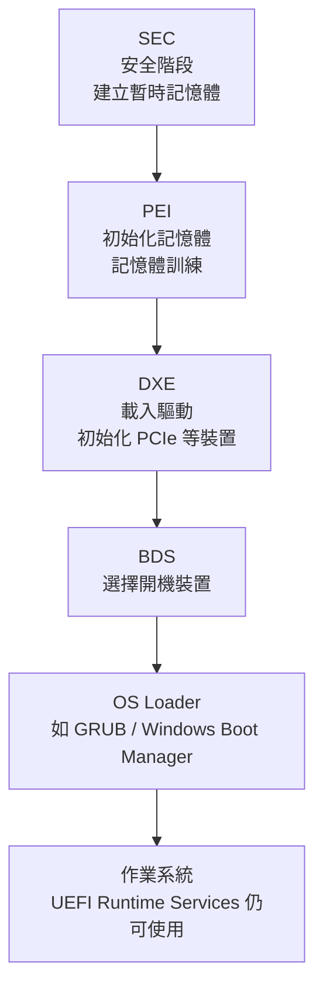
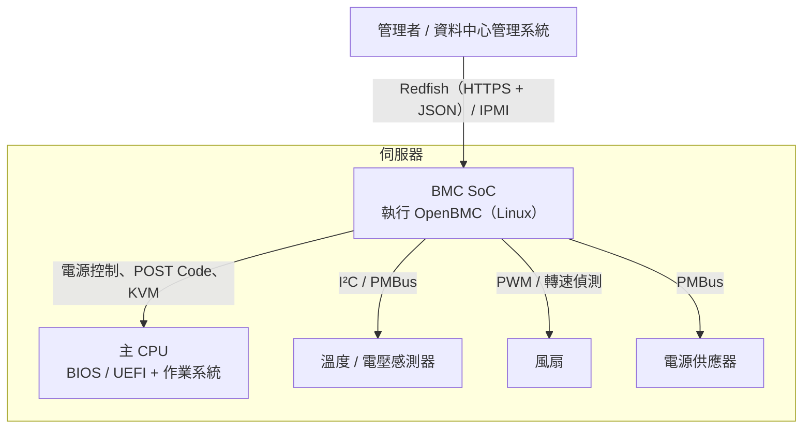

# 25. BIOS / UEFI 與 BMC（伺服器韌體）

> **一句話**：台灣是全球伺服器製造重鎮，**BIOS / UEFI 與 BMC 韌體**是本地需求量很大的韌體職缺。其中 BMC 以 Linux、C++、REST API 為主，是 Web 後端工程師最容易接軌的韌體領域。

## 學習目標

- 說明 Legacy BIOS 與 UEFI 的差異，以及 UEFI 的開機階段
- 理解 ACPI、SMBIOS、SMM、UEFI Secure Boot 等核心觀念
- 說明 BMC 的角色與功能，比較 IPMI 與 Redfish
- 了解 OpenBMC 的架構，以及軟體背景如何切入

---

## 1. 伺服器裡的韌體 🟢

一台伺服器至少有這些韌體：

| 韌體 | 執行位置 | 負責 |
|---|---|---|
| **BIOS / UEFI** | 主 CPU | 開機時初始化 CPU、記憶體、PCIe，再交給作業系統 |
| **BMC 韌體** | 主機板上獨立的 BMC 晶片 | 遠端管理、監控感測器、控制風扇與電源，**主機關機時也在運作** |
| **CPLD / FPGA** | 可程式邏輯晶片 | 電源開關順序、硬體訊號控制 |
| **周邊韌體** | 網卡、RAID 卡、SSD、GPU | 各自的控制器 |
| **EC 韌體**（筆電） | 嵌入式控制器 | 鍵盤、電池、風扇、電源按鍵 |

## 2. 從 BIOS 到 UEFI 🟡

| | Legacy BIOS | UEFI |
|---|---|---|
| 年代 | 1980 年代 | 2000 年代起取代 BIOS |
| 執行模式 | 16 位元真實模式 | 32 / 64 位元 |
| 開發 | 大量組合語言 | **C 語言**，模組化（驅動、協定） |
| 開機磁碟 | MBR，最大約 2TB | **GPT**，支援超大磁碟 |
| 安全 | 無 | **UEFI Secure Boot** |
| 其他 | — | 網路開機、圖形化設定畫面、Shell |

> 現在多數人說的「BIOS」實際上都是 UEFI 韌體。

### UEFI 開機階段

- **SEC**：處理器重置後最先執行，建立信任根與暫時記憶體（此時 DRAM 還不能用，常用 CPU 快取暫代）
- **PEI**：初始化記憶體控制器並做**記憶體訓練**（調整時序），伺服器開機慢的主要原因之一
- **DXE**：載入大量驅動，列舉 PCIe 裝置，建立 ACPI、SMBIOS 等表格
- **BDS**：依開機順序找到作業系統載入程式

### 產業生態

- **EDK II**：TianoCore 維護的開源 UEFI 開發框架，業界基礎
- **IBV（獨立 BIOS 廠商）**：AMI、Insyde（台灣系微）、Phoenix，提供商業 UEFI 程式碼給主機板與伺服器廠
- **晶片初始化程式**：Intel FSP、AMD openSIL / AGESA，由 CPU 廠提供
- **coreboot**：開源替代方案，Chromebook 與部分資料中心使用

## 3. BIOS 工程師必懂觀念 🟡

| 觀念 | 白話 |
|---|---|
| **POST** | 開機自我測試；卡住時從 **POST Code**（除錯卡或 BMC 記錄）判斷停在哪個階段 |
| **ACPI** | 韌體提供給作業系統的**硬體描述與電源管理介面**（表格如 DSDT、FADT、MADT），作業系統據此管理睡眠、CPU 狀態、裝置 |
| **SMBIOS** | 系統資訊表（廠商、型號、序號、記憶體配置），Linux 用 `dmidecode` 讀取 |
| **SMM** | 系統管理模式，CPU 的最高權限模式，作業系統看不到，用於處理特定硬體事件；也是安全攻擊的高價值目標 |
| **Option ROM** | 擴充卡（網卡、RAID 卡）自帶的韌體，在開機時由 UEFI 載入 |
| **Capsule Update** | UEFI 標準的韌體更新機制，可從作業系統觸發 |
| **UEFI Secure Boot** | 開機時驗證 OS Loader 的簽章，金鑰階層為 **PK → KEK → db（允許）/ dbx（禁止）** |

## 4. BMC：伺服器的「管家」🟡

**BMC（Baseboard Management Controller）**是主機板上一顆獨立的小型 SoC，有自己的處理器、記憶體與網路埠。**只要伺服器插著電，即使主機關機，BMC 也在運作**。

**主要功能**：
- **遠端電源控制**：開機、關機、重開機
- **感測器監控**：溫度、電壓、電流、風扇轉速
- **風扇控制**：依溫度調整轉速
- **遠端 KVM**：遠端看到螢幕、操作鍵盤滑鼠，如同坐在機器前
- **虛擬媒體**：遠端掛載 ISO 安裝作業系統
- **事件日誌（SEL）**：記錄硬體錯誤
- **韌體更新**：更新 BIOS、BMC 本身與其他元件韌體

**硬體**：資料中心伺服器的 BMC 晶片主要來自台灣的 **信驊（ASPEED）**，如 AST2600、AST2700 系列。

### BMC 系統架構

## 5. IPMI vs Redfish 🟡

| | IPMI | Redfish |
|---|---|---|
| 年代 | 1998 年起 | 2015 年起，由 DMTF 制定 |
| 格式 | 二進位指令 | **RESTful API + JSON over HTTPS** |
| 安全性 | 設計老舊，已知多項弱點 | 使用標準 HTTPS 與現代認證 |
| 擴充性 | 有限，各廠商 OEM 指令不一 | 以 Schema 定義資源模型，易擴充 |
| 工具 | `ipmitool` | `curl`、任何 HTTP 用戶端、各語言 SDK |
| 現況 | 舊系統仍大量使用 | **新一代標準**，資料中心逐步轉移 |

Redfish 例子：`GET /redfish/v1/Systems/1` 取得系統資訊、`POST .../Actions/ComputerSystem.Reset` 重開機。**這就是你熟悉的 REST API 設計**（[第 05 章](05-backend-api.md)）。

## 6. OpenBMC：軟體工程師的切入點 🟡

**OpenBMC** 是 Linux 基金會的開源 BMC 韌體專案，大型雲端業者與伺服器廠廣泛採用。

| 層面 | 技術 |
|---|---|
| 建置 | **Yocto**（[第 24 章](24-embedded-linux.md)） |
| 作業系統 | 嵌入式 Linux |
| 程式語言 | 以 **C++** 為主（部分 Python、Shell） |
| 元件溝通 | **D-Bus**（服務之間的訊息匯流排） |
| 對外介面 | **bmcweb** 提供 Redfish 與 Web 管理介面 |
| 硬體溝通 | I²C、PMBus、**MCTP / PLDM**（DMTF 定義的平台管理通訊協定） |

**為什麼適合軟體背景**：
- 架構是**微服務式**的 Linux 服務，透過 D-Bus 溝通，類似訊息匯流排
- 對外是 **REST API**，Web 後端經驗可直接應用
- 開發流程使用 Git、Code Review、CI，與現代軟體團隊相同

## 7. 平台安全與趨勢 🔴

- **平台韌體韌性**：NIST SP 800-193 要求韌體具備**保護、偵測、復原**能力，例如 BIOS 與 BMC 映像被竄改時能自動回復
- **硬體信任根**：開機前先驗證 BIOS 與 BMC 韌體（例如 OCP 推動的開源信任根 **Caliptra**）
- **DC-SCM**：OCP 定義的模組化設計，把 BMC 與安全元件做成獨立模組卡
- **AI 伺服器**：GPU 伺服器功耗與散熱需求大增，BMC 的電源與散熱管理、液冷監控更加重要

---

## 動手練習

1. **在自己的電腦上觀察 UEFI**：Linux 執行 `dmidecode` 查看 SMBIOS 資訊、`efibootmgr` 查看開機項目、`mokutil --sb-state` 查看 Secure Boot 狀態。
2. **在 QEMU 中執行 OpenBMC**：依官方文件下載 QEMU 用的 OpenBMC 映像並啟動，用瀏覽器登入 Web 介面。
3. **呼叫 Redfish API**：對執行中的 OpenBMC 用 `curl -k -u root:密碼 https://<位址>/redfish/v1/` 瀏覽資源樹，試著查詢系統資訊與感測器數值。
4. **用 EDK II 建置**：依 TianoCore 文件建置 OVMF（QEMU 用的 UEFI 韌體），在 QEMU 中進入 UEFI Shell。

## 面試常問

> 先試著自己回答，再對照參考解答。

### Q1. Legacy BIOS 和 UEFI 的差別？

| | Legacy BIOS | UEFI |
|---|---|---|
| 執行模式 | 16 位元真實模式，可用記憶體極有限 | 32 / 64 位元，可使用完整記憶體 |
| 開發語言 | 大量組合語言 | C 語言，模組化的驅動與協定架構 |
| 磁碟分割 | MBR，最大約 2TB、最多 4 個主要分割區 | GPT，支援超大容量與大量分割區 |
| 安全 | 無簽章驗證 | **Secure Boot** 驗證開機程式 |
| 功能 | 基本 | 網路開機、圖形介面、UEFI Shell、Runtime Services |

UEFI 透過標準化介面讓不同廠商的驅動與作業系統能互通，已全面取代 Legacy BIOS。

### Q2. 說明 UEFI 的開機階段

1. **SEC（Security）**：處理器重置後最先執行，建立信任根，用 CPU 快取作為暫時記憶體
2. **PEI（Pre-EFI Initialization）**：初始化 CPU、晶片組與**記憶體控制器，進行記憶體訓練**，之後 DRAM 才可使用
3. **DXE（Driver Execution Environment）**：載入大部分驅動，初始化 PCIe、USB、儲存、網路等裝置，建立 ACPI 與 SMBIOS 表格
4. **BDS（Boot Device Selection）**：依開機順序選擇裝置，執行 OS Loader
5. **TSL / RT**：OS Loader 載入作業系統並呼叫 `ExitBootServices()` 後，作業系統接手；之後只剩 **Runtime Services**（如讀寫 UEFI 變數、時間）

### Q3. BMC 是什麼？為什麼伺服器需要它？

**BMC** 是主機板上獨立於主 CPU 的管理控制器，有自己的處理器、記憶體、網路埠與韌體（通常是嵌入式 Linux，如 OpenBMC）。只要伺服器有電，即使主機關機或當機，BMC 都能運作。

需要的原因：資料中心有成千上萬台伺服器，不可能每台都派人到現場處理。BMC 提供**遠端開關機、感測器監控、風扇控制、遠端 KVM 與虛擬媒體、事件日誌、韌體更新**，讓管理者能遠端部署、監控與排除故障，是資料中心自動化管理的基礎。

### Q4. IPMI 和 Redfish 的差別？

- **IPMI**：1998 年起的舊標準，使用二進位指令，常見工具是 `ipmitool`。設計老舊、已知多項安全弱點、各廠商擴充指令不一致
- **Redfish**：DMTF 制定的新標準，採用 **RESTful API + JSON over HTTPS**，以 Schema 定義伺服器資源模型（系統、機箱、管理器、感測器），安全性與擴充性都較好，可用任何 HTTP 用戶端或程式語言操作

業界正從 IPMI 轉向 Redfish，新設計以 Redfish 為主、IPMI 為相容用途。

### Q5. ACPI 的用途？

**ACPI（Advanced Configuration and Power Interface）**是韌體與作業系統之間的標準介面：
- 韌體在開機時建立 **ACPI 表格**，描述系統硬體（CPU 拓撲 MADT、平台設定 FADT、裝置與方法 DSDT / SSDT）
- 作業系統讀取後進行**電源管理**（睡眠 S3、休眠 S4、CPU 效能與省電狀態）、**裝置列舉與設定**、溫度管理

ACPI 讓作業系統不必為每塊主機板撰寫專屬程式碼。ACPI 表格錯誤常造成睡眠喚醒失敗、裝置無法辨識等問題，是 BIOS 工程師常處理的議題。

### Q6. UEFI Secure Boot 的金鑰架構？

| 金鑰 / 資料庫 | 角色 |
|---|---|
| **PK（Platform Key）** | 平台擁有者金鑰（通常是主機板廠），用於管理 KEK，只有一把 |
| **KEK（Key Exchange Key）** | 可更新 db / dbx 的金鑰，例如 Microsoft 與主機板廠的金鑰 |
| **db（允許清單）** | 可信任的簽章憑證或映像雜湊 |
| **dbx（禁止清單）** | 已撤銷的憑證或有漏洞的映像雜湊 |

開機時 UEFI 驗證 OS Loader 的簽章：必須能被 db 中的憑證驗證，且不在 dbx 中，才允許執行。Linux 發行版常透過 Microsoft 簽章的 **shim** 載入自己的 GRUB 與核心。

### Q7. 什麼是 SMM？為什麼與安全有關？

**SMM（System Management Mode）**是 x86 CPU 的特殊執行模式，由系統管理中斷（SMI）觸發。進入後作業系統完全暫停，CPU 執行韌體中的 SMM 程式碼，處理電源、硬體錯誤等平台事件。SMM 的記憶體（SMRAM）作業系統無法存取。

安全意義：SMM 權限高於作業系統核心且不受作業系統監控，若 SMM 程式碼有漏洞，攻擊者可植入**作業系統與防毒軟體都無法偵測的惡意程式**，甚至修改 BIOS。因此 SMM 程式碼需嚴格驗證輸入、限制可被呼叫的功能，並鎖定 SMRAM 與 Flash 寫入權限。

### Q8. 伺服器開不了機，你會怎麼排查？

1. **確認電源**：電源供應器燈號、BMC 是否可連線（BMC 能連表示待機電源正常）
2. **看 BMC 資訊**：事件日誌（SEL）、感測器數值（電壓、溫度是否異常）、**POST Code** 停在哪個值
3. **依 POST Code 判斷階段**：卡在記憶體初始化 → 檢查記憶體條；卡在 PCIe 列舉 → 移除擴充卡逐一測試
4. **遠端 KVM 看畫面**與 BIOS 序列埠輸出
5. **最小化系統**：只保留 CPU、一條記憶體與開機碟，再逐步加回
6. 必要時**更新或回復 BIOS / BMC 韌體**（許多伺服器有備援映像）

## 常見誤解

- **「BIOS 已經被淘汰」**：Legacy BIOS 確實已被 UEFI 取代，但「BIOS 工程師」仍是業界對 UEFI 韌體工程師的通稱。
- **「BMC 只是遠端開關機」**：現代 BMC 負責散熱、電源、安全與資產管理，是資料中心自動化的核心元件，AI 伺服器時代更加重要。

## 本章回顧

- UEFI 開機：SEC → PEI → DXE → BDS → 作業系統
- BMC 是獨立的管理系統，主機關機也在運作；介面從 IPMI 走向 Redfish
- OpenBMC = Yocto + Linux + C++ + D-Bus + REST API，軟體背景容易切入
